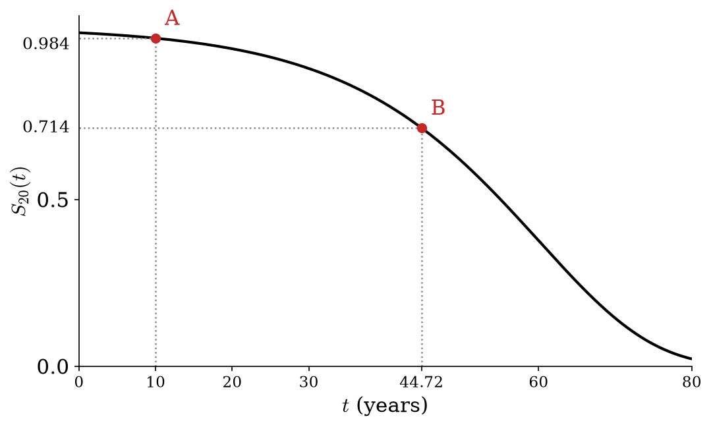
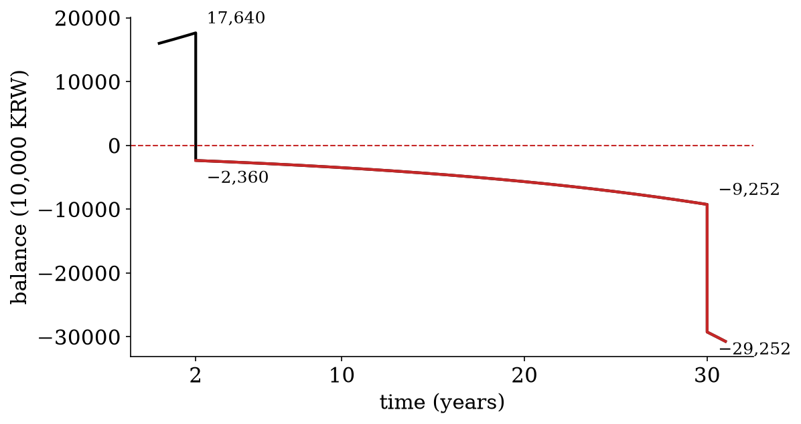
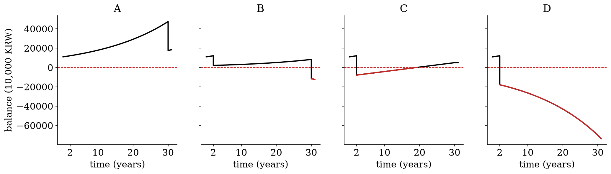
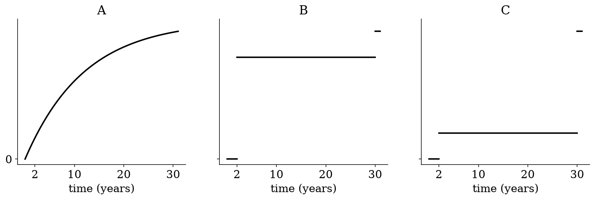



### 문제1

20세인 사람 한 명에게 보험금 1억인 보험을 판다($i = 0.05$). 아래는 이 사람의 생존함수 $S_{20}(t)$ 다. 점 A, B 는 $t = 10,\ 44.72$ 에서의 값이다.

{width=65% fig-align="center"}

`(a)` 이 사람 한 명에게서 회사가 망할 확률을 $0.016$ 으로 맞추려고 한다. 보험료를 얼마 받아야 하는가? $(v^{10} = 0.6139,\ v^{20} = 0.3769)$

`(b)` 보험료로 EPV 를 받으면 $P(1+i)^u = S$ 인 $u$ 는 $44.72$ 년이다(점 B). 이때 회사가 망할 확률은 그림에서 무엇인가?

① 점 B 의 높이 \
② 1 에서 점 B 의 높이를 뺀 것 \
③ 점 A 의 높이에서 점 B 의 높이를 뺀 것

::: {.callout-note collapse="true" title="풀이"}
\(a) 그림의 A점을 해석하면,

$$
\begin{aligned}
& S_{20}(10)=0.984 \\
\iff & 1-F_{20}(10)=0.984 \\
\iff & F_{20}(10)=0.016 \\
\iff & \text{Pr}(T_{20}\leq 10)=0.016 \\
\iff & \text{Pr}(T_{20}< 10)=0.016
\end{aligned}
$$

::: {.callout-warning title="수정"}
해설영상에서는 마지막 줄을 $\Longrightarrow$ 로 설명했는데, $\Longleftarrow$ 방향도 맞아서 $\Longleftrightarrow$ 로 수정했습니다. $T_{20}$ 이 연속확률변수라 $\text{Pr}(T_{20}=10)=0$ 이고, 그래서 $\text{Pr}(T_{20}<10)=\text{Pr}(T_{20}\leq 10)$ 입니다.
:::

정보1: 10년안에 죽을확률은 0.016 이고 10년보다 더 살 확률은 0.984 이다. \
정보2: 0.6139원은 10년 뒤에 1원이 됨 ($\because v^{10}=0.6139$)

만약에 6139만원을 받으면?

- 경우1(with prob 0.016): 10년안에 가입자가 죽고, 6139만원이 1억이 되기전에 지급 (파산O)
- 경우2(with prob 0.984): 10년뒤에 가입자가 죽고, 6139만원이 1억이 된 이후에 지급 (파산X)

\(b) 1-0.714 (1에서 B점의 높이를 뺀 것)

:::

### 문제2

남은 수명이 확률 $0.5$ 로 2년, 확률 $0.5$ 로 30년인 사람 2명을 서로 독립으로 받는다. 보험금은 1억, $i = 0.05$ 이고, 한 사람당 보험료는 정확히 EPV $S\,\mathrm{E}[Z] \approx 5{,}692$ 만원이다. $(v^2 = 0.9070,\ v^{30} = 0.2314)$

`(a)` 두 사람 중 정확히 한 사람만 2년에 죽을 확률은 얼마인가?

`(b)` (a) 처럼 죽으면 $\bar Z = \mathrm{sum}(Z)/2$ 는 얼마인가? 이때 회사는 망하는가?

`(c)` 회사가 망할 확률은 얼마인가?

::: {.callout-note collapse="true" title="풀이"}
한 사람의 분포

| $T_x$       | 2년     | 30년    |
| :---------: | :----: | :----: |
| 확률          | 0.5    | 0.5    |
| $Z=v^{T_x}$ | 0.9070 | 0.2314 |

<!-- colwidths: 4.4 4 4 -->

$E(Z)=0.5*0.9070 + 0.5*0.2314=0.5692$

두사람을 받게 되면?

| $Z_1$  | $Z_2$  | Prob | $\bar{Z}$ | $E(Z)$ | $P/S$  |
| :----: | :----: | :--: | :-------: | :----: | :----: |
| 0.9070 | 0.9070 | 1/4  | 0.9070    | 0.5692 | 0.5692 |
| 0.9070 | 0.2314 | 1/4  | 0.5692    | 0.5692 | 0.5692 |
| 0.2314 | 0.9070 | 1/4  | 0.5692    | 0.5692 | 0.5692 |
| 0.2314 | 0.2314 | 1/4  | 0.2314    | 0.5692 | 0.5692 |

<!-- colwidths: 3.8 3.8 2.4 3.8 3.7 3.7 -->

참고: 파산 $\iff$ $\bar{Z} > P/S$

\(a) 1/2 \
\(b) 0.5692, 망하지 않음 (딱 잔고가 0) \
\(c) 1/4

:::

### 문제3

남은 수명이 확률 $0.2$ 로 2년, $0.8$ 로 30년인 사람들을 서로 독립으로 $N$ 명 받는다($i = 0.05$). 한 사람의 $Z$ 는 $\mathrm{E}[Z] = 0.3665$, $\mathrm{V}[Z] = 0.0730$ 이고, $\bar Z = \mathrm{sum}(Z)/N$ 이다.

`(a)` $N = 100$ 일 때 $\bar Z$ 의 분포를 근사적으로 $N(\text{평균},\ \text{분산})$ 꼴로 써라.

`(b)` $N$ 을 $100$ 에서 $400$ 으로 늘리면 $\bar Z$ 의 표준편차는 몇 배가 되는가?

::: {.callout-note collapse="true" title="풀이"}
| $T_x$       | 2년     | 30년    |
| :---------: | :----: | :----: |
| 확률          | 0.2    | 0.8    |
| $Z=v^{T_x}$ | 0.9070 | 0.2314 |

<!-- colwidths: 4.4 4 4 -->

$E(Z) = v^2 *0.2 + v^{30}*0.8 = 0.3665$ \
$V(Z) = v^4 *0.2 + v^{60}*0.8 -(EZ)^2 = 0.0730$

$\bar{Z} \overset{\cdot}{\sim} N(EZ, VZ/N)$ \
$\bar{Z} \overset{\cdot}{\sim} N(EZ, (\text{sd}[Z]/\sqrt{N})^2)$

\(a) $평균=EZ=0.3665$, $분산=VZ/N = 0.0730/100$ \
\(b) $N$을 4배로 늘리면 분산은 1/4배가 되고 표준편차는 $\sqrt{1/4}=1/2$가 된다.

:::

### 문제4

$\text{balance}(t)$ 는 $t$ 시점의 잔고다.

`(a)` 4명을 받고 한 사람당 $4{,}000$ 만원을 받았다(보험금 1억, $i = 0.05$). 남은 수명은 2년 또는 30년이다. 아래는 이 회사의 잔고다. 2년에 몇 명, 30년에 몇 명이 죽었는가?

{width=60% fig-align="center"}

`(b)` 아래 넷은 잔고 그래프다. 보험료는 처음에 한 번만 받고 죽을 때 보험금을 주는 이 설정에서 나올 수 없는 것은 어느 것인가?

{width=100% fig-align="center"}

`(c)` 2명을 받았는데 한 명은 2년에, 다른 한 명은 30년에 죽었다. $\mathrm{sum}_t(Z)$ 는 $t$ 시점까지 죽은 사람들의 $Z$ 만 더한 것이다. $\mathrm{sum}_t(Z)$ 의 그래프로 그럴듯한 것은 A, B, C 중 어느 것인가?

{width=80% fig-align="center"}

::: {.callout-note collapse="true" title="풀이"}
\(a) 2년에 2명, 30년에 2명 \
\(b) C \
\(c) B

:::

### 문제5

남은 수명이 확률 $0.2$ 로 2년, $0.8$ 로 30년인 사람 $N = 4$ 명을 서로 독립으로 받고, 한 사람당 $P = 3{,}500$ 만원을 받았다. 보험금은 1억, $i = 0.05$ 다. $(v^2 = 0.9070,\ v^{30} = 0.2314)$

`(a)` 파산하는 사건을 $\bar Z > c$ 꼴로 쓸 때 $c$ 는 얼마인가?

`(b)` 2년에 몇 명 이상 죽으면 파산하는가?

`(c)` 같은 사람들을 이번에는 몇 명을 받든 한 사람당 $9{,}500$ 만원씩 받기로 했다. 회사가 망할 확률은 얼마인가?

::: {.callout-note collapse="true" title="풀이"}
| $T_x$       | 2년     | 30년    |
| :---------: | :----: | :----: |
| 확률          | 0.2    | 0.8    |
| $Z=v^{T_x}$ | 0.9070 | 0.2314 |

<!-- colwidths: 4.4 4 4 -->

네사람을 받게되면

| case  | Prob | $\bar{Z}$ | $E(Z)$ | $P/S$ |
| :---: | :--: | :-------: | :----: | :---: |
| (0,4) |      | 0.2314    | 0.3665 | 0.35  |
| (1,3) |      | 0.4003    | 0.3665 | 0.35  |
| (2,2) |      | 0.5692    | 0.3665 | 0.35  |
| (3,1) |      | 0.7381    | 0.3665 | 0.35  |
| (4,0) |      | 0.9070    | 0.3665 | 0.35  |

<!-- colwidths: 3.8 2.4 3.8 3.7 3.7 -->

::: {.callout-warning title="정정"}
해설영상에서는 이 표의 $E(Z)$ 를 $0.5692$ 로 잘못 썼습니다. 문제5 의 사람은 확률 $0.2$ 로 2년, $0.8$ 로 30년이라 $E(Z) = 0.2 \times 0.9070 + 0.8 \times 0.2314 = 0.3665$ 입니다. 파산하는지는 $\bar{Z}$ 와 $P/S = 0.35$ 를 견주어 정하므로 (a)(b)(c) 의 답은 그대로입니다.
:::

\(a) 0.35 \
\(b) 1명이라도 죽으면 파산임. \
\(c) 0

:::

### 문제6

$N$ 명을 받고 한 사람당 보험료 $P$ 를 받았다. 보험금은 $S$, 이자율은 $i$ 다. 옳은 것을 모두 고르라.

① 보험금과 보험료를 둘 다 두 배로 올리면 파산하는 사건은 그대로다. \
② 파산하는 사건 $\bar Z > P/S$ 에는 이자율이 보이지 않으므로, 이자율이 바뀌어도 파산할 확률은 그대로다. \
③ 한 사람당 보험료는 그대로 두고 $N$ 을 늘려도, 파산하는 사건은 $\bar Z > P/S$ 로 쓸 수 있다.

::: {.callout-note collapse="true" title="풀이"}
파산 $\iff$ $\bar{Z} > P/S$

1번: 맞음 \
2번: 틀렸음 ($\bar{Z}$는 이자율이 반영되어 있음. 이자율이 올라가도 파산하는 사건은 여전히 $\bar{Z} > P/S$ 로 쓸 수 있겠지만 좌변값($\bar{Z}$)이 작아지게 되어 부등식이 성립하기 어려워 지므로 파산할 확률은 줄어든다.) \
3번: 맞음

:::

### 문제7

서로 독립이고 같은 생존함수를 따르는 사람을 $N$ 명 받는다(보험금 1억). 남은 수명은 하나의 값으로 정해져 있지 않다. $N$ 이 아주 클 때 파산할 확률에 대해 답하라.

`(a)` 한 사람당 EPV 보다 100만원 더 받을 때, 파산할 확률은 어디로 가는가?

`(b)` 한 사람당 EPV 만큼 받을 때, 파산할 확률은 어디로 가는가?

`(c)` 한 사람당 EPV 보다 100만원 덜 받을 때, $N$ 이 클 때의 파산할 확률은 $1/2$ 보다 큰가, 작은가?

::: {.callout-note collapse="true" title="풀이"}
\(a) 0으로 수렴 \
\(b) 1/2로 수렴 \
\(c) 1/2보다 큼 (1로 수렴)

:::
