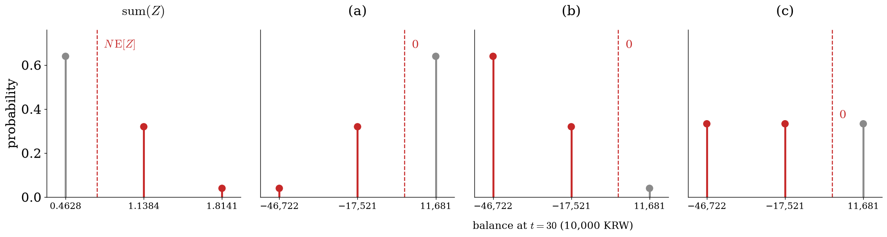

# 1. 강의영상

# 2. 연습문제

`# 예제1` -- (이론4) 남은 수명이 확률 $0.2$ 로 2년, 확률 $0.8$ 로 30년인 사람들을 서로 독립으로 $N = 2$ 명 받고, 한 사람당 EPV 만큼($P = 3{,}665$ 만원) 받았다. 보험금은 $S = 10{,}000$ 만원, $i = 0.05$ 다. 왼쪽은 $\mathrm{sum}(Z)$ 의 분포다 — 값은 $0.46$ (둘 다 30년), $1.14$ (한 명 2년), $1.81$ (둘 다 2년) 이고 확률은 $0.64,\ 0.32,\ 0.04$ 다. 오른쪽 (a)(b)(c) 중 모두 죽은 뒤($t = 30$) 남은 돈의 분포는 어느 것인가?

{width=100% fig-align="center"}

`(풀이)` 

`(a)` 다.

`# 예제2` -- (이론5) 남은 수명 $T$ 의 분포가 아래 왼쪽과 같은 사람 한 명이 있다. $i = 0.05$, $v = 1/1.05$ 이고, 필요한 $v$ 의 거듭제곱은 오른쪽에 적어 두었다.

::: {.tblrow}

| $T$ | 2 | 30 |
|---|---|---|
| 확률 | 0.2 | 0.8 |

| $v^2$ | $v^{30}$ | $v^4$ | $v^{60}$ |
|---|---|---|---|
| 0.9070 | 0.2314 | 0.8227 | 0.0535 |

:::

`(1)` $Z = v^T$ 의 분포표를 만들고 $\mathrm{E}[Z]$ 를 구하라.

`(2)` $Z^2$ 의 분포표를 만들고 $\mathrm{E}[Z^2]$ 을 구하라.

`(3)` $\mathrm{V}[Z]$ 를 구하라.

`(풀이)`

`(1)` $Z$ 는 $T$ 가 2 이면 $v^2$, 30 이면 $v^{30}$ 이다. 확률은 $T$ 의 것을 그대로 가져온다.

| $Z = v^T$ | $v^2 = 0.9070$ | $v^{30} = 0.2314$ |
|---|---|---|
| 확률 | 0.2 | 0.8 |

$\mathrm{E}[Z] = 0.2 \times 0.9070 + 0.8 \times 0.2314 = 0.3665$.

`(2)` $Z^2 = (v^T)^2 = (v^2)^T$ 이므로 $v$ 자리에 $v^2$ 을 넣은 것이다.

| $Z^2 = (v^2)^T$ | $v^4 = 0.8227$ | $v^{60} = 0.0535$ |
|---|---|---|
| 확률 | 0.2 | 0.8 |

$\mathrm{E}[Z^2] = 0.2 \times 0.8227 + 0.8 \times 0.0535 = 0.2074$.

`(3)` $\mathrm{V}[Z] = \mathrm{E}[Z^2] - \mathrm{E}[Z]^2 = 0.2074 - 0.3665^2 \approx 0.0731$.
