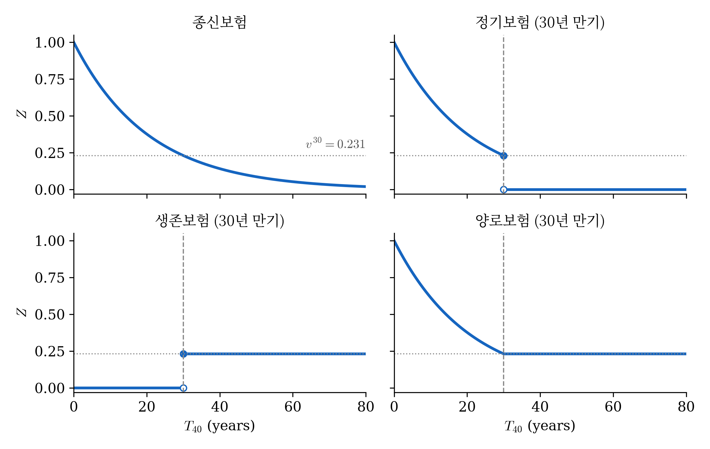

# 1. 강의영상

>강의실 사정으로 촬영을 하지 못했습니다. 

# 2. 보충계획

`(1)` 진도보충 매주 1시간씩? 

`(2)` 조별프로젝트2-3회 진행설명 및 해설, 프로젝트는 레포트점수에 배점을 크게 하지 않은 채 반영할 예정

`(3)` 자유주제로 특강 (AI 활용법) // 월,화,수,목 오후6시-7시30분 

>의견이 있으시면 guebin@jbnu.ac.kr 11월4일 23:59까지 의견 주시기 바랍니다. 
>
>- 예시1: (2)를 선호합니다. 
>- 예시2: (1),(3)을 선호합니다. // (2)를 선호하지 않는다는 의미

# 3. 여러가지 보험들

`-` 지금까지 우리가 다룬 보험 = 종신보험 (죽는 순간 보험금 $S$ 를 지급)

`-` 다른 종류의 보험도 있음. 

- 정기보험(term insurance): $n$ 년 안에 죽으면 죽는 순간 줌. $n$ 년을 넘겨 살면 아무것도 주지 않음. 
- 생존보험(pure endowment): $n$ 년을 넘겨 살면 $n$ 년 뒤에 줌. 그 전에 죽으면 아무것도 주지 않음. 
- 양로보험(endowment insurance): $n$ 년 안에 죽으면 죽는 순간 주고, $n$ 년을 넘겨 살면 $n$ 년 뒤에 줌. 어느 쪽이든 한 번은 준다.

`-` 보험의 종류가 달라지면? $T_x$ 는 동일, 그러나 $Z$는 바뀜. 

$$
Z_{\text{종신}} = v^{T_x}, \qquad
Z_{\text{정기}} = \begin{cases} v^{T_x} & T_x \le n \\ 0 & T_x > n \end{cases}, \qquad
Z_{\text{생존}} = \begin{cases} 0 & T_x < n \\ v^{n} & T_x \ge n \end{cases}, \qquad
Z_{\text{양로}} = v^{\min(T_x,\, n)}
$$

  - 경계를 $\le$ 쪽에 붙이든 $<$ 쪽에 붙이든 값이 같음. $T_x$ 는 연속확률변수라 $T_x = n$ 일 확률은 0 이다.

`-` 아래 그림은 $x = 40$, $n = 30$, $i = 0.05$ 에서 네 $Z$ 를 $T_{40}$ 의 함수로 그린 것이다. 가로 점선은 $v^{30} = 0.231$ 이다.

{width=90% fig-align="center"}

`# 예제1` 보험회사는 타임머신이 있어서 열 사람의 남은 수명을 안다. 40세인 열 사람(남은 수명 2년, 7년, 12년, 17년, 22년, 27년, 30년, 37년, 42년, 47년)에게 보험금 1억, 기간 30년으로 네 약속(종신 · 정기 · 생존 · 양로)을 판다고 할 때, 각 사람이 네 약속에서 받는 돈의 지금 값($10^8 \times Z$, $i = 0.05$)을 살펴보자(단위 만원).

|              | 종신    | 정기 30년 | 생존 30년 | 양로 30년 |
| ------------ | ----: | -----: | -----: | -----: |
| 사람1 (수명=2)   | 9,070 | 9,070  | 0      | 9,070  |
| 사람2 (수명=7)   | 7,107 | 7,107  | 0      | 7,107  |
| 사람3 (수명=12)  | 5,568 | 5,568  | 0      | 5,568  |
| 사람4 (수명=17)  | 4,363 | 4,363  | 0      | 4,363  |
| 사람5 (수명=22)  | 3,418 | 3,418  | 0      | 3,418  |
| 사람6 (수명=27)  | 2,678 | 2,678  | 0      | 2,678  |
| 사람7 (수명=30)  | 2,314 | 2,314  | 2,314  | 2,314  |
| 사람8 (수명=37)  | 1,644 | 0      | 2,314  | 2,314  |
| 사람9 (수명=42)  | 1,288 | 0      | 2,314  | 2,314  |
| 사람10 (수명=47) | 1,009 | 0      | 2,314  | 2,314  |

<!-- colwidths: 7.642858 2.428572 3.892858 3.892858 3.892858 -->

  - 정기 + 생존 = 양로 
  - 사람7 은 딱 30년에 죽음. 교재는 (Dickson et al, 2020) 정기보험을 $T_x \le n$ 이면 주고, 생존보험을 $T_x \ge n$ 이면 주는 것으로 정의하므로 이 사람에서만 정기 + 생존 = 양로 가 맞지 않음. 그러나 사실 $T_x$ 는 연속확률변수라(p. 34) 딱 30년에 죽을 확률이 0 이어서 크게 신경 쓸 필요 없음. (그리고 생존보험은 단독판매하지도 않음)  

# 4. 종신보험 

`-` 종신보험은 계약자가 언제 사망하든 사망할 때 일시금 급부를 지급 (지금까지 다룬것)

`-` 일반적으로 종신보험은 사망급부에 비해 정기보험보다 훨씬 비쌈. 

- 왜? 중도에 계약을 포기하는 경우를 제외하면 사망급부를 지급할 확률이 100% 이기 때문 

`-` 보험료를 정기적으로 내는 계약에서는 보험료를 어떤 최고 연령, 보통 80~90세까지만 내는 경우가 많음. (종신보험의 요점은 계약자가 언제 사망하든 사망급부를 지급해야 한다는 것인데, 나이 들어 형편이 어려워지거나 스스로 일을 처리할 능력이 떨어져 보험료를 못 내서 계약이 끊기면 이 목적을 이루지 못하기 때문)

 `-` 중도해지: 보험료를 그만 내고 싶다면? 

- 전통적으로 종신보험 계약자가 처음 얼마 동안이 지난 뒤 계약을 그만두기로 하면, 쌓인 보험료 가운데 투자 부분을 나타내는 해약환급금(cash value 또는 surrender value)을 받을 수 있었음. 
- lapse-supported insurance: 최근에는 일부 나라에서 해약해도 환급금이 없는 종신보험을 파는 일이 흔해짐. 그만두는 사람이 남는 사람의 보험료를 대 주는 셈 (대신 모두의 보험료를 싸게 낮출 수 있음)
  
# 5. 정기보험

`-` 정기보험의 계약 기간은 보통 10년에서 30년

`-` 정기보험의 보험료는 보통 보험금액에 비해 매우 작음. 

  - 보험회사가 발행한 계약 가운데 작은 비율에만 사망급부를 지급하면 되기 때문
  - 예를 들어 40세인 계약자가 10년 정기보험에 들면, 보험회사가 그 계약에서 사망급부를 지급할 확률(곧 그 사람이 50세 전에 사망할 확률)은 2% 쯤임. 그러므로 이런 계약의 98% 쯤은 사망급부 없이 만기가 되고, 이 계약들의 보험료가 사망급부를 지급해야 하는 2% 의 급부를 대 주는 구조. 

`-` 정기보험의 목적1: 가족 보호. 

  - 비교적 적은 월 비용으로, 계약자가 사망했을 때 배우자와 자녀가 경제적 어려움을 겪지 않게 지켜 줄 수 있음. 

`-` 정기보험의 목적2: 핵심 직원이 사망해 생기는 손실로부터 회사를 지키는 것. 

  - 회사가 보험료를 내고, 그 직원이 기간 안에 사망하면 회사가 보험금액을 받음
  - 회사는 피보험이익(insurable interest), 곧 그 직원이 사망하면 회사가 실제로 경제적 손실을 입는다는 것을 입증해야 함. 
  - 이런 보험을 예전에는 Key Person Insurance 라 불렀고, 지금은 흔히 COLI(Company Owned Life Insurance)라 부름.

`-` 정기보험의 목적3: 남은 주택담보대출을 갚는 것.

  - 주택담보대출과 함께 쓰여 (은행이 요구하기도 함), 계약자가 사망하면 남은 대출을 보험금으로 갚음.
  - 그래서 가족이 계약자가 사망한 뒤 대출금을 갚느라 애쓰지 않아도 됨. 
  - 사망급부가 기간에 걸쳐 줄어드는 decreasing term insurance. 

`-` 중도해지: 정기보험 계약자는 보험료를 그만 내고 계약을 끝낼 수 있음. 

- 계약 종료 이후 계약자는 보험료를 더 내지 않고 보험회사도 아무것도 지급하지 않음 
- 그동안 낸 보험료는?  돌려주지 않음. (그 기간의 사망 방어 비용) 

`-` 만기 이후 옵션1: renewable term insurance 

	- 처음 기간이 끝날 때, 건강 상태를 다시 묻지 않고 최고 연령까지 계약을 갱신할 수 있게 해 줌. 
-	 사망급부를 지급할 확률이 커지므로 갱신한 계약의 보험료는 처음보다 비싸짐
- 그러나 건강과 상관없이 보험에 들 수 있음이 보장됨 (그때 암에 걸렸든 건강이 나빠졌든, 보험회사가 갱신을 거절하지 못함. 이것을 "insurability is guaranteed", 곧 가입 자격 보장이라고 함)

`-` 만기 이후 옵션2: convertible term insurance 

- 처음 기간이 끝날 때 종신보험으로 바꿀 수 있게 해 줌. 바꿀 때 건강 상태를 묻지 않지만, 바꿀 수 있는 최고 연령(보통 75세 안팎)이 있을 수 있음. 

# 6. 생존보험

`-` 생존보험 급부는 단독 계약으로 판매되지 않으며 정기보험 급부와 함께 판매되어 양로보험을 이룰 수 있음. 

# 7. 양로보험

`-` 양로보험(endowment insurance)은 계약자가 사망할 때와 정해진 기간이 끝날 때 가운데 먼저 오는 때에 일시금 급부를 지급. 

- 결국 정기보험과 기간이 정해진 투자를 섞은 꼴
- 계약자가 사망하면 정기보험에서처럼 보험금액이 지급되고, 계약자가 살아 있으면 계약이 끝날 때 보험금액이 지급됨

`-` 양로보험은 북미나 영국의 주요 보험회사에서는 더 이상 팔지 않음.

-  양로보험의 주된 목적중 하나는 투자인데, 수익률이 낮고 융통성이 없어서 20세기 후반에 널리 나온 갖가지 순수 투자 상품과 경쟁할 수 없었음. 
  - 그런데 흥미롭게도, 전통적인 양로보험은 개발도상국에서, 특히 금액이 작은 소액보험(microinsurance)으로 점점 인기를 얻고 있음. (양로보험 = 정기보험 + 만기 저축: 기간 안에 죽으면 보험금, 살아남으면 만기금으로 목돈)
