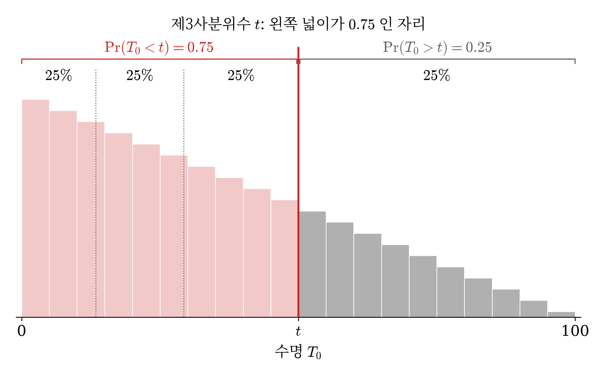
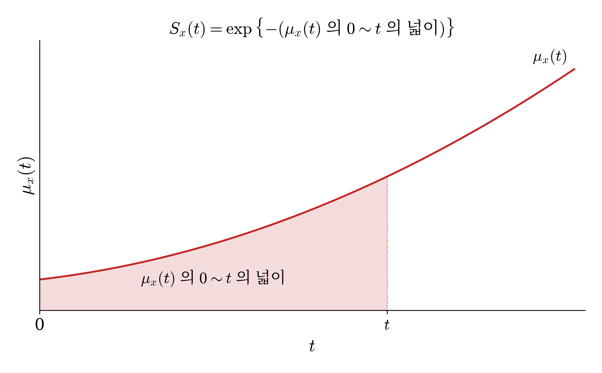
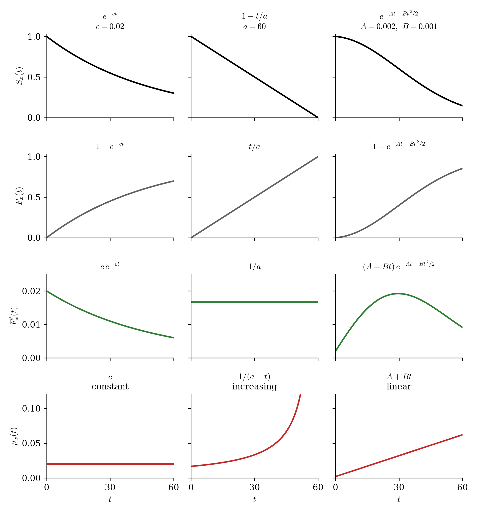
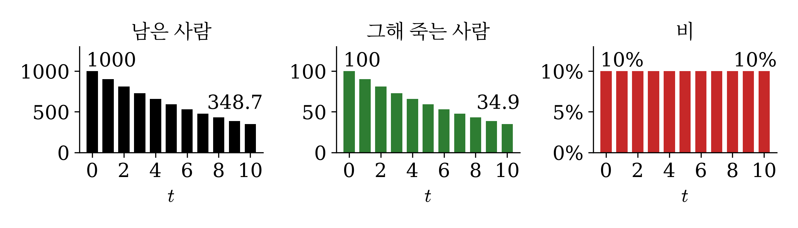
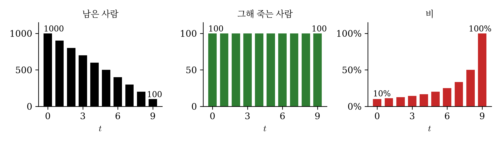
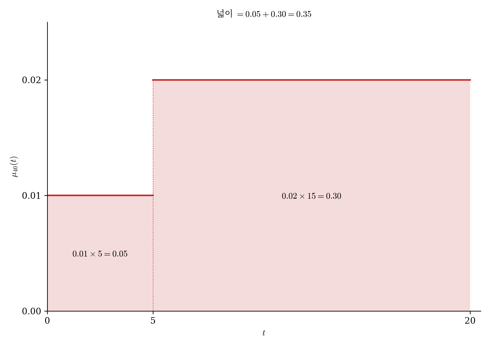
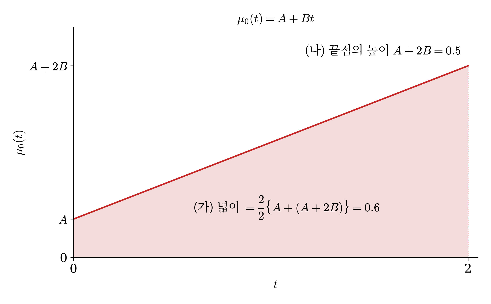

# 1. 강의영상



# 2. 보충방식

`-` 아래 중 하나의 방법으로 하려고 합니다. 

1. 자유주제 특강
2. 진도보강 
3. 혼합 

`-` 프로젝트를 선택한 사람이 없음. 

# 3. 보험계리사 시험

`-` 보험계리사 시험 소개: 보험계리사 시험은 1차와 2차로 나뉜다. 1차에 합격한 뒤, 2차를 응시한다. 

|      | 1차 | 2차 |
|------|-----|-----|
| 꼴   | 객관식 4지선다, 과목당 40문항 | 약술형 · 풀이형, 5과목 |
| 과목 | 보험계약법 · 보험업법 · 근퇴법, 경제학원론, 보험수학, 회계원리 (영어는 공인영어 성적으로 대체) | 계리리스크관리, 보험수리학, 연금수리학 등 |
| 합격 | 매 과목 40점 이상, 평균 60점 이상 | 과목마다 60점 이상. 1차 합격 후 5년 안에 5과목을 모으면 최종 합격 |

- 시험은 한 해 한 번.  2차는 몇 해에 걸쳐 붙을 수 있음.
- 2025년 말 보험사 소속 계리사는 1,474명이고, 업계에서는 3,000명 이상 필요하다고 봄.
- 급여로 견주면 2026년 9급 공무원 초임 보수가 세전 연 3,428만 원이고, 은행 신입 기본급이 5천만 원대. 그런데 경력 5년 이상 계리사의 총보상은 1억 ~ 1억 5천만 원이라는 채용 업계 자료가 있음.
- 우리는 1차 보험수학 40문항 가운데 보험수리 쪽을 다룸. 2018 ~ 2026 아홉 회분 평균으로 수학 · 통계 약 20문항, 이자론 약 6문항, 보험수리 약 14문항. 

`-` 기출문제예시 

`# 예제 1 (2025 1차 27번)` 아래의 식 중 $S_x(t)$ 와 같은 것을 고르시오. (단, $u > 0$)

① $[S_x(t) - S_x(t+u)] - S_x(t+u)$ \
② $F_x(t+u) - F_x(t) + S_x(t+u)$ \
③ $F_x(t) - F_x(t+u) + S_{x+u}(t)$ \
④ $F_x(t) - F_x(t+u) - S_{x+u}(t)$

`(풀이)`

$F = 1 - S$ 를 넣으면 ② $= [1 - S_x(t+u)] - [1 - S_x(t)] + S_x(t+u) = S_x(t)$. ① 은 $S_x(t) - 2S_x(t+u)$ 이고, ③ · ④ 에는 $S_{x+u}(t)$ 가 섞여 일반에는 $S_x(t)$ 가 아니다.

답: ②

::: {.callout-note collapse="true" title="실제 기출은 이러하다"}
아래의 식 중 ${}_tp_x$ 와 같은 것을 고르시오. (단, $u > 0$)

① ${}_{t\vert u}q_x - {}_{t+u}p_x$ \
② ${}_{t+u}q_x - {}_tq_x + {}_{t+u}p_x$ \
③ ${}_tq_x - {}_{t+u}q_x + {}_tp_{x+u}$ \
④ ${}_tq_x - {}_{t+u}q_x - {}_tp_{x+u}$

**시험지의 기호**

| 시험지 | 뜻 | 우리 기호 |
|----|----------|--------|
| ${}_tp_x$ | $x$ 세인 사람이 $t$ 년 뒤에도 살아 있을 확률 | $S_x(t) = \Pr(T_x > t)$ |
| ${}_tq_x$ | $x$ 세인 사람이 $t$ 년 안에 죽을 확률 | $F_x(t) = \Pr(T_x \le t)$ |
| ${}_{u\vert t}q_x$ | $x$ 세인 사람이 $u$ 년은 살고 그다음 $t$ 년 안에 죽을 확률. $t = 1$ 이면 ${}_{u\vert}q_x$ 로 쓴다 | $S_x(u) - S_x(u+t) = \Pr(u < T_x \le u+t)$ |
:::

`#`

`# 예제 2 (2021 1차 29번)` 확률변수 $T_0$ 가 신생아의 수명을 나타낼 때, $T_0$ 의 생존함수가

$$S_0(t) = \left(1 - \dfrac{t}{100}\right)^2, \quad 0 \le t \le 100$$

이다. $T_0$ 의 분포에서 제3사분위수(quartile)를 구하시오.

① 25  ② 40  ③ 50  ④ 75

`(풀이)` 이 생존함수를 따르는 수명 $T_0$ 를 히스토그램으로 그리면 아래와 같다. 제3사분위수 $t$ 는 왼쪽 넓이가 $0.75$ 가 되는 자리, 곧 $\Pr(T_0 < t) = 0.75$ 인 $t$ 다.

{width=75% fig-align="center"}

$\Pr(T_0 < t) = 0.75$ 이면 $\Pr(T_0 > t) = S_0(t) = 0.25$ 다. $\left(1 - \dfrac{t}{100}\right)^2 = 0.25$ 이므로 $1 - \dfrac{t}{100} = 0.5$ 에서 $t = 50$.

답: ③ 50

::: {.callout-note collapse="true" title="실제 기출은 이러하다"}
확률변수 $X$가 신생아의 수명을 나타낼 때, $X$의 생존함수가 $s_X(x) = \left(1 - \dfrac{x}{100}\right)^2$, $0 \le x \le 100$ 이다. $X$의 분포에서 제3사분위수(quartile)를 구하시오.

① 25  ② 40  ③ 50  ④ 75

**시험지의 기호**

| 시험지 | 뜻 | 우리 기호 |
|----|----------|--------|
| $X$ | 이 문항이 정한 확률변수 | $T_0$ |
| $s_X(x)$ | 확률변수 $X$ 의 생존함수 | $S_0(t)$ |
:::

`#`

# 4. 사망력
 
`-` 생존함수 복습: $S_x(t) = \dfrac{S_0(x+t)}{S_0(x)}$, $\ S_x(t+u) = S_x(t)\,S_{x+t}(u)$, $\ F_x(t) = 1 - S_x(t)$.

`-` 사력(force of mortality, 사망력): $x$ 세인 사람이 [$t$ 년 뒤까지 살아 있을 때, 그 순간]{style="color:#C62828"} 죽을 것 같은 느낌을 수치화 한 것. (확률은 아님, 그 비슷한 것) 
$$
\begin{aligned}
\mu_x(t) &:= \lim_{h \to 0+} \frac{1}{h}\Pr(T_x \le t+h \mid T_x > t) \\
&= \lim_{h \to 0+} \frac{1}{h} \cdot \frac{F_x(t+h) - F_x(t)}{S_x(t)} = \frac{F_x'(t)}{S_x(t)} \\
&= -\frac{S_x'(t)}{S_x(t)} = -\frac{d}{dt}\log S_x(t) \qquad \left(F_x = 1 - S_x,\ \ \frac{d}{dt}\log g(t) = \frac{g'(t)}{g(t)}\right)
\end{aligned}
$$

`-` 사력과 생존함수의 관계  $$S_x(t^\star) = \exp\left\{-\int_0^{t^\star} \mu_x(t)\,dt\right\}$$

- $\int_0^{t^\star} \mu_x(t)\,dt$ 는 사력 곡선의 $0 \sim t^\star$ 의 넓이다. 그래서 $S_x(t^\star) = \exp\{-(\mu_x(t) \text{ 의 } 0 \sim t^\star \text{ 의 넓이})\}$ 로 읽는다. 넓이를 알면 적분 없이 $S_x(t^\star)$ 가 나온다.

{width=75% fig-align="center"}

`-` 여러 모양의 $S_x(t)$ 에서 $\mu_x(t)$ 를 살펴보자. ($a$, $c$, $A$, $B$ 는 양의 상수다.)

| $S_x(t)$ | $\log S_x(t)$ | $\mu_x(t)$ | 사력의 모양 |
|---|---|---|---|
| $e^{-ct}$ | $-ct$ | $c$ | 일정하다 |
| $1 - \dfrac{t}{a}$ | $\log(a - t) - \log a$ | $\dfrac{1}{a - t}$ | 커진다 |
| $\left(1 - \dfrac{t}{a}\right)^2$ | $2\log(a - t) - 2\log a$ | $\dfrac{2}{a - t}$ | 커진다 |
| $\exp\left\{-At - \dfrac{B}{2}t^2\right\}$ | $-At - \dfrac{B}{2}t^2$ | $A + Bt$ | 직선으로 커진다 |

`-` $\mu_x(t) = \dfrac{F_x'(t)}{S_x(t)}$ 로 그려 보자.

{width=100% fig-align="center"}

`-` case1: 사망력이 상수

- 나이를 먹어도 죽을 위험이 그대로인 경우다. 해마다 남은 사람의 같은 비율이 죽는다. 처음 1000명이고 비는 10% 라고 하자.

| 시점  | 남은 사람 | 그해 죽는 사람 | 비   |
| --- | ----- | -------- | --- |
| 0년  | 1000  | 100      | 10% |
| 1년  | 900   | 90       | 10% |
| 2년  | 810   | 81       | 10% |
| 3년  | 729   | 72.9     | 10% |
| 4년  | 656.1 | 65.6     | 10% |
| 5년  | 590.5 | 59.0     | 10% |
| 6년  | 531.4 | 53.1     | 10% |
| 7년  | 478.3 | 47.8     | 10% |
| 8년  | 430.5 | 43.0     | 10% |
| 9년  | 387.4 | 38.7     | 10% |
| 10년 | 348.7 | 34.9     | 10% |

{width=100% fig-align="center"}

`-` case2: 드무아브르 법칙: $S_x(t) = 1 - \dfrac{t}{a}$, $0 \le t \le a$. 곧 $T_x$ 는 $(0, a)$ 의 균등분포다.

- $T_x$가 균등분포이므로 해마다 사망자수가 같음.

| 시점 | 남은 사람 | 그해 죽는 사람 | 비 |
|---|---|---|---|
| 0년 | 1000 | 100 | 10% |
| 1년 | 900 | 100 | 11.1% |
| 2년 | 800 | 100 | 12.5% |
| 3년 | 700 | 100 | 14.3% |
| 4년 | 600 | 100 | 16.7% |
| 5년 | 500 | 100 | 20% |
| 6년 | 400 | 100 | 25% |
| 7년 | 300 | 100 | 33.3% |
| 8년 | 200 | 100 | 50% |
| 9년 | 100 | 100 | 100% |
| $t$ 년 | $1000\left(1 - \dfrac{t}{10}\right)$ | 100 | $\dfrac{1}{10 - t}$ |

- 그해 죽는 사람은 그대로인데 남은 사람이 줄어서 비가 커진다. 그래서 $\mu_x(t)$ 가 커진다.

{width=100% fig-align="center"}

# 5. 기출

`# 예제 3 (2025 1차 28번)` [사망률]{style="color:#C62828"}^[시험지 원문 그대로 썼음. 혼란의 여지가 있는 단어임.] $S_x(t) - S_x(t+1) = 0.10$ $(t = 0, 1, \cdots, 9)$ 일 때, $S_{x+5}(3)$ 을 구하시오.

① 0.40  ② 0.60  ③ 0.72  ④ 0.80

`(풀이)` $S_x(0) = 1$ 에서 시작해 차례로 넣으면 다음과 같다.

$$S_x(1) = 1 - 0.1 = 0.9, \quad S_x(2) = 0.9 - 0.1 = 0.8, \quad \cdots, \quad S_x(t) = 1 - 0.1\,t = 1 - \frac{t}{10}$$

표로 그리면 다음과 같다.

| $t$ | $S_x(t)$ | 수식 |
|---|---|---|
| 0 | 1 | $S_x(0) = 1$ |
| 1 | 0.9 | $S_x(1) = S_x(0) - 0.1$ |
| 2 | 0.8 | $S_x(2) = S_x(1) - 0.1$ |
| 3 | 0.7 | $S_x(3) = S_x(2) - 0.1$ |
| 4 | 0.6 | $S_x(4) = S_x(3) - 0.1$ |
| 5 | 0.5 | $S_x(5) = S_x(4) - 0.1$ |
| 6 | 0.4 | $S_x(6) = S_x(5) - 0.1$ |
| 7 | 0.3 | $S_x(7) = S_x(6) - 0.1$ |
| 8 | 0.2 | $S_x(8) = S_x(7) - 0.1$ |
| 9 | 0.1 | $S_x(9) = S_x(8) - 0.1$ |
| 10 | 0 | $S_x(10) = S_x(9) - 0.1$ |
$S_x(8) = S_x(5)\,S_{x+5}(3)$ 를 이용하면 $S_{x+5}(3) = 0.2 / 0.5 = 0.4$.

답: ① 0.40

> Note: 해마다 죽는 사람 수가 일정하므로 case2의 그림을 상상하면 되지만 문제풀이에는 별 이득이 없다. 그냥 단순 생존함수해석문제. 

::: {.callout-note collapse="true" title="실제 기출은 이러하다"}
사망률 ${}_{t\vert}q_x = 0.10$ $(t = 0, 1, \cdots, 9)$ 일 때, ${}_3p_{x+5}$ 를 구하시오.

① 0.40  ② 0.60  ③ 0.72  ④ 0.80

**시험지의 기호**

| 시험지 | 뜻 | 우리 기호 |
|----|----------|--------|
| ${}_tp_x$ | $x$ 세인 사람이 $t$ 년 뒤에도 살아 있을 확률 | $S_x(t) = \Pr(T_x > t)$ |
| ${}_{u\vert t}q_x$ | $x$ 세인 사람이 $u$ 년은 살고 그다음 $t$ 년 안에 죽을 확률. $t = 1$ 이면 ${}_{u\vert}q_x$ 로 쓴다 | $S_x(u) - S_x(u+t) = \Pr(u < T_x \le u+t)$ |
:::

> Note: [시험지는 ${}_{t\vert}q_x$ 를 사망률이라 불렀는데 정확한 표현이 아니다. 다른 해 시험지는 사망률을 $q_x$ 에 쓴다.]{style="color:#C62828"}

`# 예제 4 (2021 1차 28번)` $F_x(t)$ 가 $t$ 에 관해 미분 가능할 때, $\displaystyle\lim_{h \to 0+} \frac{F_x(h)}{h}$ 를 구하시오.

① $\mu_x(0)$  ② $S_x(1)$  ③ $F_x(1)$  ④ $S_x(1)\,\mu_x(0)$

`(풀이)`

$$
\begin{aligned}
&\lim_{h \to 0+} \frac{F_x(h)}{h} = \lim_{h \to 0+} \frac{F_x(h) - F_x(0)}{h} \quad (\because F_x(0) = 0) \\
&\quad = F_x'(0) \quad (\because \text{미분의 정의}) \\
&\quad = \frac{F_x'(0)}{S_x(0)} \quad (\because S_x(0) = 1) \\
&\quad = \mu_x(0) \quad \left(\because \mu_x(t) = \frac{F_x'(t)}{S_x(t)} \text{ 에 } t = 0 \text{ 을 넣는다}\right)
\end{aligned}
$$

답: ① $\mu_x(0)$

::: {.callout-note collapse="true" title="실제 기출은 이러하다"}
${}_tq_x$가 $t$에 관해 미분 가능할 때, $\lim_{h \to 0+} \dfrac{{}_hq_x}{h}$를 구하시오.

① $\mu_x$  ② $p_x$  ③ $q_x$  ④ $p_x\mu_x$

**시험지의 기호**

| 시험지 | 뜻 | 우리 기호 |
|----|----------|--------|
| ${}_tq_x$ | $x$ 세인 사람이 $t$ 년 안에 죽을 확률 | $F_x(t) = \Pr(T_x \le t)$ |
| $p_x$ · $q_x$ | 기간이 1년이면 왼쪽 아래첨자를 뗀다. $p_x = {}_1p_x$, $q_x = {}_1q_x$ | $S_x(1)$ · $F_x(1)$ |
| $\mu_x$ | $x$ 세의 사력(force of mortality). $\mu_x = \lim_{h \to 0+} \dfrac{1}{h}\Pr(T_0 \le x+h \mid T_0 > x)$ | $\mu_x(0)$ |
:::

`#`

`# 예제 5 (2022 1차 27번)` $\displaystyle\lim_{h \to 0+} \frac{S_x(t) - S_x(t+h)}{h}$ 를 구하시오.

① $S_x(t)$  ② $\mu_x(t)$  ③ $S_{x+t}(1)$  ④ $S_x(t)\,\mu_x(t)$

`(풀이)`

$$
\begin{aligned}
&\lim_{h \to 0+} \frac{S_x(t) - S_x(t+h)}{h} = -\lim_{h \to 0+} \frac{S_x(t+h) - S_x(t)}{h} \quad (\because \text{분자의 부호를 바꾼다}) \\
&\quad = -S_x'(t) \quad (\because \text{미분의 정의}) \\
&\quad = F_x'(t) \quad (\because F_x(t) = 1 - S_x(t)) \\
&\quad = S_x(t)\,\mu_x(t) \quad \left(\because \mu_x(t) = \frac{F_x'(t)}{S_x(t)}\right)
\end{aligned}
$$

답: ④ $S_x(t)\,\mu_x(t)$

::: {.callout-note collapse="true" title="실제 기출은 이러하다"}
$\displaystyle\lim_{h\to0+}\frac{{}_{k\vert h}q_x}{h}$ 를 구하시오.

① ${}_kp_x$  ② $\mu_{x+k}$  ③ $p_{x+k}$  ④ ${}_kp_x\,\mu_{x+k}$

**시험지의 기호**

| 시험지 | 뜻 | 우리 기호 |
|----|----------|--------|
| ${}_tp_x$ | $x$ 세인 사람이 $t$ 년 뒤에도 살아 있을 확률 | $S_x(t) = \Pr(T_x > t)$ |
| $p_x$ · $q_x$ | 기간이 1년이면 왼쪽 아래첨자를 뗀다. $p_x = {}_1p_x$, $q_x = {}_1q_x$ | $S_x(1)$ · $F_x(1)$ |
| ${}_{u\vert t}q_x$ | $x$ 세인 사람이 $u$ 년은 살고 그다음 $t$ 년 안에 죽을 확률. $t = 1$ 이면 ${}_{u\vert}q_x$ 로 쓴다 | $S_x(u) - S_x(u+t) = \Pr(u < T_x \le u+t)$ |
| $\mu_{x+t}$ | $x+t$ 세의 사력. 시험지는 사력을 나이 하나로 적는다 | $\mu_x(t)$ |
:::

`#`

`# 예제 6 (2020 1차 38번)` 피보험자 $(40)$ 에 대하여 사력이 다음과 같다.

$$\mu_{40}(t) = \begin{cases} 0.01, & 0 \le t < 5, \\ 0.02, & 5 \le t. \end{cases}$$

이 사람의 $S_{40}(20)$ 의 값을 구하시오. (단, $e^{-0.1} = 0.9048$, $e^{-0.05} = 0.9512$)

① 0.70  ② 0.75  ③ 0.80  ④ 0.85

`(풀이)` 사력이 $t = 5$ 에서 바뀌므로 적분을 둘로 나눈다.

$$
\begin{aligned}
S_{40}(20) &= \exp\left\{-\int_0^{20} \mu_{40}(t)\,dt\right\} \\
&= \exp\left\{-\int_0^5 0.01\,dt - \int_5^{20} 0.02\,dt\right\} = e^{-0.35}
\end{aligned}
$$

따라서 $S_{40}(20) = (e^{-0.1})^3\,e^{-0.05} = 0.9048^3 \times 0.9512 = 0.705$.

`(넓이 풀이)` $S_{40}(20) = \exp\{-(\mu_{40}(t) \text{ 의 } 0 \sim 20 \text{ 의 넓이})\}$ 이다. 사력이 계단 꼴이라 넓이는 직사각형 둘이다.

{width=75% fig-align="center"}

$$(\mu_{40}(t) \text{ 의 } 0 \sim 20 \text{ 의 넓이}) = 0.01 \times 5 + 0.02 \times 15 = 0.35$$

따라서 $S_{40}(20) = e^{-0.35} = (e^{-0.1})^3\,e^{-0.05} = 0.9048^3 \times 0.9512 = 0.705$.

답: ① 0.70

::: {.callout-note collapse="true" title="실제 기출은 이러하다"}
피보험자 $(40)$에 대하여 사력이 다음과 같다.

$$\mu_{40+t} = \begin{cases} 0.01, & 0 \le t < 5, \\ 0.02, & 5 \le t. \end{cases}$$

이 사람의 ${}_{20}p_{40}$의 값을 구하시오. (단, $e^{-0.1} = 0.9048$, $e^{-0.05} = 0.9512$)

① 0.70  ② 0.75  ③ 0.80  ④ 0.85

**시험지의 기호**

| 시험지 | 뜻 | 우리 기호 |
|----|----------|--------|
| ${}_tp_x$ | $x$ 세인 사람이 $t$ 년 뒤에도 살아 있을 확률 | $S_x(t) = \Pr(T_x > t)$ |
| $\mu_{x+t}$ | $x+t$ 세의 사력. 시험지는 사력을 나이 하나로 적는다 | $\mu_x(t)$ |
:::

`#`

`# 예제 7 (2019 1차 31번)` 피보험자에 대하여 사력이 다음과 같다.

$$\mu_0(t) = A + Bt, \quad t \ge 0$$

이로부터 얻은 생존함수 $S_0(t)$ 가 다음 두 조건을 만족할 때, $A$ 를 구하시오.

::: {style="border: 1px solid #c8c8c8; padding: 16px 14px 0 14px; margin: 0.6em 0;"}
(가) $S_0(2) = e^{-0.6}$

(나) $-\dfrac{S_0'(2)}{S_0(2)} = 0.5$
:::

① 0.10  ② 0.30  ③ 0.50  ④ 0.70

`(풀이)` (가) 의 $S_0(2)$ 를 사력으로 쓴다.

$$
\begin{aligned}
S_0(2) &= \exp\left\{-\int_0^2 \mu_0(t)\,dt\right\} \\
&= \exp\left\{-\int_0^2 (A + Bt)\,dt\right\} = \exp\{-2A - 2B\}
\end{aligned}
$$

(가) 에서 $2A + 2B = 0.6$, (나) 는 $\mu_0(2) = A + 2B = 0.5$. 풀면 $B = 0.2$, $A = 0.1$.

`(넓이 풀이)` $\mu_0(t) = A + Bt$ 의 그래프를 그린다. $t = 0$ 의 높이가 $A$, $t = 2$ 의 높이가 $A + 2B$ 인 직선이다.

{width=75% fig-align="center"}

(가) 는 $\mu_0(t)$ 의 $0 \sim 2$ 의 넓이가 $0.6$ 이라는 말이다. $S_0(2) = \exp\{-(\mu_0(t) \text{ 의 } 0 \sim 2 \text{ 의 넓이})\}$ 이기 때문이다. 사력이 직선이라 넓이는 사다리꼴이다.

$$(\mu_0(t) \text{ 의 } 0 \sim 2 \text{ 의 넓이}) = \frac{2}{2}\{A + (A + 2B)\} = 2A + 2B = 0.6$$

(나) 는 끝점의 높이가 $0.5$ 라는 말이다. 사력의 식 $\mu_0(t) = -\dfrac{S_0'(t)}{S_0(t)}$ 에 $t = 2$ 를 넣은 것이 (나) 의 왼쪽이기 때문이다.

$$(\text{끝점의 높이}) = \mu_0(2) = A + 2B = 0.5$$

두 식을 연립한다. 첫 식에서 둘째 식을 빼면 $A = 0.1$ 이고, $A + 2B = 0.5$ 에서 $B = 0.2$ 다.

답: ① 0.10

::: {.callout-note collapse="true" title="실제 기출은 이러하다"}
피보험자 $(x)$에 대하여 사력이 다음과 같다. $\mu_x = A + Bx$, $x \ge 0$. 이로부터 얻은 생존함수 ${}_tp_0$가 다음 두 조건을 만족할 때, $A$를 구하시오.

::: {style="border: 1px solid #c8c8c8; padding: 16px 14px 0 14px; margin: 0.6em 0;"}
(가) ${}_2p_0 = e^{-0.6}$

(나) $\left(-\frac{1}{{}_tp_0}\frac{d}{dt}\,{}_tp_0\right)\Big\vert_{t=2} = 0.5$
:::

① 0.10  ② 0.30  ③ 0.50  ④ 0.70

**시험지의 기호**

| 시험지 | 뜻 | 우리 기호 |
|----|----------|--------|
| ${}_tp_x$ | $x$ 세인 사람이 $t$ 년 뒤에도 살아 있을 확률 | $S_x(t) = \Pr(T_x > t)$ |
| $\mu_x$ | $x$ 세의 사력(force of mortality). $\mu_x = \lim_{h \to 0+} \dfrac{1}{h}\Pr(T_0 \le x+h \mid T_0 > x)$. 이 문항의 $x$ 는 우리의 $t$ 다 | $\mu_0(t)$ |
| $\left(-\dfrac{1}{{}_tp_0}\dfrac{d}{dt}\,{}_tp_0\right)\Big\vert_{t=2}$ | 괄호 안을 $t$ 의 식으로 계산한 뒤 $t = 2$ 를 넣는다 | $-\dfrac{S_0'(2)}{S_0(2)}$ |
:::

`#`
