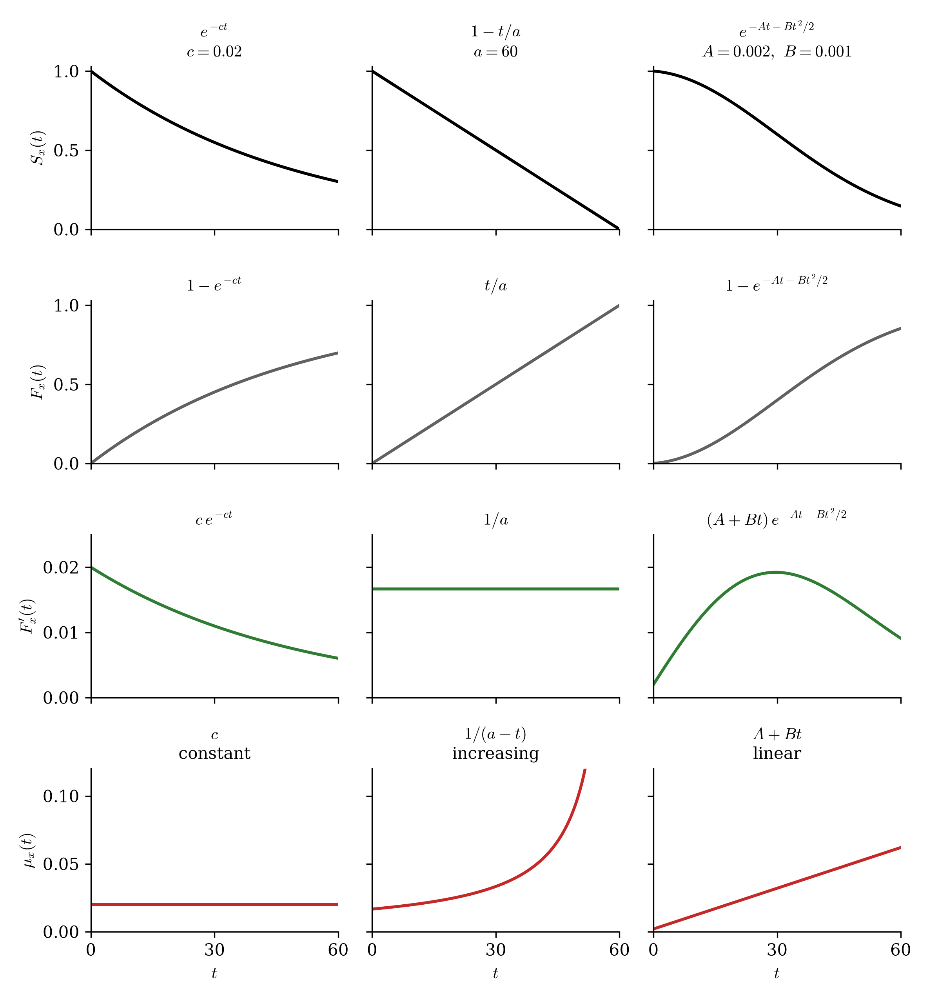

# 1. 강의영상

# 2. 사력 (개념 및 기출문제) 

`-` 아래의 그래프를 기억하자.

{width=100% fig-align="center"}

`-` 그림의 $c = 0.02$, $a = 60$, $A = 0.002$, $B = 0.001$ 은 예로 든 값이다. $a$, $c$, $A$, $B$ 는 $t$ 와는 상관없는 상수지만, 상황에 따라(예를 들어 나이 $x$ 에 따라) 값이 달라질 수 있다.

`-` case1,case2 에 대하여 아래의 그림도 대응하여 기억하면 편리하다. 
{width=100% fig-align="center"}

`-` 아래와 같이 해석하면 (조금 틀리긴 하지만) 편리하다. 
	
| 대상         | 해석                                                                     |
| ---------- | ---------------------------------------------------------------------- |
| $S_x(t)$   | $t$시점 생존자수                                                             |
| $F_x(t)$   | $t$시점 누적사망자수                                                           |
| $F'_x(t)$  | $[t,t+h)$ 구간에서 사망한 사람수                                                 |
| $\mu_x(t)$ | $[t,t+h)$ 구간에서 $\frac{구간에서 사망한 사람수}{구간시작시생존자수}=\frac{F'_x(t)}{S_x(t)}$ |

<!-- colwidths: 3 20 -->

- 틀린부분1: $S_x(t)\times N$이 사실 생존자수이다. 
- 틀린부분2: $F_x(t)\times N$이 사실 누적사망자수이다. 
- 틀린부분3: $F'_x(t)\times h \times N$이 사실 구간사망자수이다. 
- 틀린부분4: $\mu_x(t)\times h\times N$이 사실은 $\frac{구간에서 사망한 사람수}{구간시작시생존자수}$이다.

`# 예제 1 (2023 1차 36번)` 사력 $\mu_0(t) = \dfrac{1}{120-t}$, $0 < t < 120$ 일 때, $S_{40}(4) - S_{40}(9)$ 를 구하시오.

① $\dfrac{1}{15}$  ② $\dfrac{1}{16}$  ③ $\dfrac{1}{17}$  ④ $\dfrac{1}{18}$

`(풀이1)` 

$$
\begin{aligned}
&S_0(t) = \exp\left\{-\int_0^t \mu_0(s)\,ds\right\} \\
&\quad = \exp\left\{-\int_0^t \frac{ds}{120-s}\right\} = \exp\{\log(120-t) - \log 120\} = \frac{120-t}{120}
\end{aligned}
$$

따라서 $S_{40}(t) = \dfrac{S_0(40+t)}{S_0(40)} = \dfrac{80-t}{80}$ 이다. $S_{40}(4) - S_{40}(9) = \dfrac{76 - 71}{80} = \dfrac{1}{16}$.

`(풀이2)` $\mu_x(t) = \mu_0(x+t)$ 이므로 40세의 사력은 $$\mu_{40}(t) = \mu_0(40+t) = \dfrac{1}{120-(40+t)} = \dfrac{1}{80-t}$$ 이다. 이는 case2 의 $\mu_x(t) = \dfrac{1}{a-t}$ 에서 $a = 80$ 인 꼴이므로 $S_{40}(t) = 1 - \dfrac{t}{80}$ 이다. 따라서 $S_{40}(4) - S_{40}(9) = \dfrac{9 - 4}{80} = \dfrac{1}{16}$. 

`(풀이3)` case2 이므로 $T_{40}$ 은 $(0, 80)$ 의 균등분포다. $S_{40}(4) - S_{40}(9) = \Pr(4 < T_{40} \le 9)$ 는 구간 길이의 비이므로$\dfrac{9 - 4}{80} = \dfrac{1}{16}$.

답: ② $\dfrac{1}{16}$

::: {.callout-note collapse="true" title="실제 기출은 이러하다"}
사력 $\mu_x = \frac{1}{120-x}$, $0 < x < 120$ 일 때, ${}_{4\vert 5}q_{40}$ 을 구하시오.

① $\frac{1}{15}$  ② $\frac{1}{16}$  ③ $\frac{1}{17}$  ④ $\frac{1}{18}$

**시험지의 기호**

| 시험지 | 뜻 | 우리 기호 |
|----|----------|--------|
| ${}_{u\vert t}q_x$ | $x$ 세인 사람이 $u$ 년은 살고 그다음 $t$ 년 안에 죽을 확률. $t = 1$ 이면 ${}_{u\vert}q_x$ 로 쓴다 | $S_x(u) - S_x(u+t) = \Pr(u < T_x \le u+t)$ |
| $\mu_x$ | $x$ 세의 사력(force of mortality). $\mu_x = \lim_{h \to 0+} \dfrac{1}{h}\Pr(T_0 \le x+h \mid T_0 > x)$. 이 문항의 $x$ 는 우리의 $t$ 다 | $\mu_0(t)$ |
:::

`#`

`# 예제 2 (2019 1차 30번)` 피보험자에 대하여 사력이 다음과 같다.

$$\mu_0(t) = \dfrac{1}{100-t}, \quad 0 \le t < 100$$

피보험자 $(60)$ 의 장래생존기간이 $T_{60}$ 일 때, $\Pr(T_{60} > t) = \dfrac34$ 인 $t$ 값을 구하시오.

① 10  ② 15  ③ 20  ④ 30

`(풀이1)` 

$$
\begin{aligned}
&S_0(t) = \exp\left\{-\int_0^t \mu_0(s)\,ds\right\} \\
&\quad = \exp\left\{-\int_0^t \frac{ds}{100-s}\right\} = \exp\{\log(100-t) - \log 100\} = 1 - \frac{t}{100}
\end{aligned}
$$

따라서 $S_{60}(t) = \dfrac{S_0(60+t)}{S_0(60)} = \dfrac{40-t}{40}$ 다. 이제 $\dfrac{40-t}{40} = \dfrac34$ 을 풀면 $t = 10$.

`(풀이2)` $\mu_x(t) = \mu_0(x+t)$ 이므로 60세의 사력은 $$\mu_{60}(t) = \mu_0(60+t) = \dfrac{1}{100-(60+t)} = \dfrac{1}{40-t}$$ 이다. 이는 case2 의 $\mu_x(t) = \dfrac{1}{a-t}$ 에서 $a = 40$ 인 꼴이므로 $S_{60}(t) = 1 - \dfrac{t}{40}$ 이다. 이제 $1 - \dfrac{t}{40} = \dfrac34$을 풀면 $t = 10$. 

`(풀이3)` case2 이므로 $T_{60}$ 은 $(0, 40)$ 의 균등분포다. $\Pr(T_{60} > t) = \dfrac34$ 이면 $t$ 는 이 구간의 왼쪽에서 $\dfrac14$ 되는 자리다. 따라서 $t = 40 \times \dfrac14 = 10$.

답: ① 10

::: {.callout-note collapse="true" title="실제 기출은 이러하다"}
피보험자 $(x)$에 대하여 사력이 다음과 같다. $\mu_x = \frac{1}{100-x}$, $0 \le x < 100$. 피보험자 (60)의 완전미래생존기간(complete future lifetime) 확률변수가 $T_{60}$일 때, $\Pr(T_{60} > t) = \frac34$인 $t$값을 구하시오.

① 10  ② 15  ③ 20  ④ 30

**시험지의 기호**

| 시험지 | 뜻 | 우리 기호 |
|----|----------|--------|
| $\mu_x$ | $x$ 세의 사력(force of mortality). $\mu_x = \lim_{h \to 0+} \dfrac{1}{h}\Pr(T_0 \le x+h \mid T_0 > x)$. 이 문항의 $x$ 는 우리의 $t$ 다 | $\mu_0(t)$ |
:::

`#`

`# 예제 3 (2023 1차 30번)` 사력 $\mu_0(t) = \dfrac{1}{3+t}$, $t \ge 0$ 일 때 $S_0(4)$ 를 구하시오.

① $\dfrac17$  ② $\dfrac29$  ③ $\dfrac37$  ④ $\dfrac49$

`(풀이)` 사력을 넣으면 생존함수가 나온다.

$$
\begin{aligned}
&S_0(4) = \exp\left\{-\int_0^4 \mu_0(t)\,dt\right\} \\
&\quad = \exp\left\{-\int_0^4 \frac{dt}{3+t}\right\} = \exp\left\{-\log\frac{7}{3}\right\} = \frac{3}{7}
\end{aligned}
$$

답: ③ $\dfrac37$

::: {.callout-note collapse="true" title="실제 기출은 이러하다"}
사력 $\mu_x = \frac{1}{3+x}$, $x \ge 0$ 일 때 ${}_4p_0$ 를 구하시오.

① $\frac17$  ② $\frac29$  ③ $\frac37$  ④ $\frac49$

**시험지의 기호**

| 시험지 | 뜻 | 우리 기호 |
|----|----------|--------|
| ${}_tp_x$ | $x$ 세인 사람이 $t$ 년 뒤에도 살아 있을 확률 | $S_x(t) = \Pr(T_x > t)$ |
| $\mu_x$ | $x$ 세의 사력(force of mortality). $\mu_x = \lim_{h \to 0+} \dfrac{1}{h}\Pr(T_0 \le x+h \mid T_0 > x)$. 이 문항의 $x$ 는 우리의 $t$ 다 | $\mu_0(t)$ |
:::

`#`

`# 예제 4 (2018 1차 26번)` 다음 중 $\dfrac{d}{dx}S_x(t)$ 와 같은 것을 고르시오.

① $S_x(t)\,(\mu_x(0) - \mu_x(t))$ \
② $-S_x(t)\,(\mu_x(0) - \mu_x(t))$ \
③ $S_x(t)\,\mu_x(t)$ \
④ $-S_x(t)\,\mu_x(t)$

`(풀이)`

$$
\begin{aligned}
&\frac{d}{dx}S_x(t) = \frac{d}{dx}\frac{S_0(x+t)}{S_0(x)} \quad \left(\because S_x(t) = \frac{S_0(x+t)}{S_0(x)}\right) \\
&\quad = \frac{S_0'(x+t)\,S_0(x) - S_0(x+t)\,S_0'(x)}{S_0(x)^2} \quad (\because \text{몫의 미분}) \\
&\quad = \frac{S_0(x+t)}{S_0(x)}\left\{\frac{S_0'(x+t)}{S_0(x+t)} - \frac{S_0'(x)}{S_0(x)}\right\} \quad (\because \text{공통인수로 묶는다}) \\
&\quad = S_x(t)\,\{-\mu_x(t) + \mu_x(0)\} \quad \left(\because \mu_x(t) = -\frac{S_x'(t)}{S_x(t)} = -\frac{S_0'(x+t)}{S_0(x+t)}\right) \\
&\quad = S_x(t)\,(\mu_x(0) - \mu_x(t))
\end{aligned}
$$

답: ①

::: {.callout-note collapse="true" title="실제 기출은 이러하다"}
다음 중 $\frac{d}{dx}\,{}_tp_x$와 같은 것을 고르시오.

① ${}_tp_x\,(\mu_x - \mu_{x+t})$ \
② $-{}_tp_x\,(\mu_x - \mu_{x+t})$ \
③ ${}_tp_x\,\mu_{x+t}$ \
④ $-{}_tp_x\,\mu_{x+t}$

**시험지의 기호**

| 시험지 | 뜻 | 우리 기호 |
|----|----------|--------|
| ${}_tp_x$ | $x$ 세인 사람이 $t$ 년 뒤에도 살아 있을 확률 | $S_x(t) = \Pr(T_x > t)$ |
| $\mu_x$ | $x$ 세의 사력(force of mortality). $\mu_x = \lim_{h \to 0+} \dfrac{1}{h}\Pr(T_0 \le x+h \mid T_0 > x)$ | $\mu_x(0)$ |
| $\mu_{x+t}$ | $x+t$ 세의 사력. 시험지는 사력을 나이 하나로 적는다 | $\mu_x(t)$ |
:::

`#`

# 3. 생명표 (CFM, UDD)

`-` 우리가 원래 배운건 생존함수임. 그런데 실제로는 생명표를 주는 경우가 많음. 

{width=75% fig-align="center"}

`-` 비워진 부분 $[t,t+1)$을 채우는 방법은 2개가 있음. 

- 상수사력(CFM, case1): $\mu_x(t)$가 해당 구간에서 동일하다고 가정
- 사망의균등분포(UDD, case2): $F'_x(t)$가 해당구간에서 동일하다고 가정 

`# 예제 5 (2018 1차 27번)` 연령 $[x, x+1)$ 에서 단수부분에 대해 사력이 일정(CFM)하다고 가정하여 $F_{x+0.3}(0.5) = 0.2$ 를 얻었다. 만약 단수부분에 대해 사망자수 균등분포(UDD)를 가정할 때 $S_x(0.5)$ 를 구하시오.

① 0.80  ② 0.81  ③ 0.82  ④ 0.83

`(풀이1)` 사력이 일정하다는 . 생명표가 주는 것은 1년의 두 끝 $S_x(0) = 1$ 과 $S_x(1)$ 이고, 두 가정은 그 사이를 메우는 방식만 다르다.

{width=75% fig-align="center"}

`(풀이2)` 먼저 CFM 으로 $S_x(1)$ 을 구한다. $[x, x+1)$ 에서 사력이 상수 $\mu$ 이면 그 안에서 $t$ 년을 더 살 확률은 $e^{-\mu t}$ 이고, $S_x(1) = e^{-\mu}$ 다.

$$
\begin{aligned}
&S_{x+0.3}(0.5) = 1 - F_{x+0.3}(0.5) = 1 - 0.2 = 0.8 \\
&\quad = e^{-0.5\mu} \quad (\because \text{CFM}) \\
&\quad = (e^{-\mu})^{0.5} = S_x(1)^{0.5}
\end{aligned}
$$

그래서 $S_x(1) = 0.8^2 = 0.64$ 다. 이제 UDD 로 $S_x(0.5)$ 를 구한다.

$$
\begin{aligned}
&S_x(0.5) = 1 - F_x(0.5) \\
&\quad = 1 - 0.5\,F_x(1) \quad (\because \text{UDD: } F_x(t) = t\,F_x(1)) \\
&\quad = 1 - 0.5\,\{1 - S_x(1)\} \\
&\quad = 1 - 0.5 \times 0.36 = 0.82
\end{aligned}
$$

답: ③ 0.82

::: {.callout-note collapse="true" title="실제 기출은 이러하다"}
연령 $[x, x+1)$에서 단수부분에 대해 사력이 일정(CFM)하다고 가정하여 ${}_{0.5}q_{x+0.3} = 0.2$를 얻었다. 만약 단수부분에 대해 사망자수 균등분포(UDD)를 가정할 때 ${}_{0.5}p_x$를 구하시오.

① 0.80  ② 0.81  ③ 0.82  ④ 0.83

**시험지의 기호**

| 시험지 | 뜻 | 우리 기호 |
|----|----------|--------|
| ${}_tp_x$ | $x$ 세인 사람이 $t$ 년 뒤에도 살아 있을 확률 | $S_x(t) = \Pr(T_x > t)$ |
| ${}_tq_x$ | $x$ 세인 사람이 $t$ 년 안에 죽을 확률 | $F_x(t) = \Pr(T_x \le t)$ |
:::

`#`

`# 예제 6 (2018 1차 28번)` $F_x(1) = 0.1$, $F_{x+1}(1) = 0.2$ 이고, 단수부분에 대해 사망자수 균등분포(UDD)를 가정한다. 장래생존기간 $T_x$ 의 확률밀도함수를 $F_x'(t)$ 라 할 때, $F_x'(1.5)$ 를 구하시오.

① 0.14  ② 0.16  ③ 0.18  ④ 0.2

`(풀이1)` 구하는 것은 $t = 1.5$ 에서의 밀도 $F_x'(1.5)$ 다. 따라서 $1 \le t \le 2$ 에서 $F_x(t)$ 를 $t$ 의 식으로 쓰고 미분한다.

$$
\begin{aligned}
&F_x(t) = 1 - S_x(t) \\
&\quad = 1 - S_x(1)\,S_{x+1}(t-1) \quad (\because S_x(1+u) = S_x(1)\,S_{x+1}(u)) \\
&\quad = 1 - S_x(1)\,\{1 - F_{x+1}(t-1)\} \\
&\quad = 1 - S_x(1)\,\{1 - (t-1)\,F_{x+1}(1)\} \quad (\because \text{UDD}, \ 0 \le t-1 \le 1) \\
&\quad = 1 - 0.9\,\{1 - 0.2\,(t-1)\} \quad (\because S_x(1) = 1 - F_x(1) = 0.9, \ F_{x+1}(1) = 0.2)
\end{aligned}
$$

$t$ 로 미분하면 $F_x'(t) = 0.9 \times 0.2 = 0.18$ 로 $1 < t < 2$ 에서 일정하다. 따라서 $F_x'(1.5) = 0.18$.

`(풀이2)` 

{width=75% fig-align="center"}

답: ③ 0.18

::: {.callout-note collapse="true" title="실제 기출은 이러하다"}
$q_x = 0.1$, $q_{x+1} = 0.2$이고, 단수부분에 대해 사망자수 균등분포(UDD)를 가정한다. 장래생존기간 $T(x)$의 확률밀도함수를 $f(t)$라 할 때, $f(1.5)$를 구하시오.

① 0.14  ② 0.16  ③ 0.18  ④ 0.2

**시험지의 기호**

| 시험지 | 뜻 | 우리 기호 |
|----|----------|--------|
| $p_x$ · $q_x$ | 기간이 1년이면 왼쪽 아래첨자를 뗀다. $p_x = {}_1p_x$, $q_x = {}_1q_x$ | $S_x(1)$ · $F_x(1)$ |
| $T(x)$ | $x$ 세인 사람의 장래생존기간(future lifetime). 시험지에 따라 완전미래생존기간이라고도 쓴다 | $T_x$ |
| $f(t)$ | $T_x$ 의 밀도 | $F_x'(t)$ |
:::

`#`

`# 예제 7 (2020 1차 31번)` 다음과 같은 생명표가 주어져 있다.

| $t$ | $N S_0(t)$ | $N\,(S_0(t) - S_0(t+1))$ | $S_{60}(t-60) - S_{60}(t-59)$ |
|---|---|---|---|
| 60 | 1,000 | | |
| 61 | | 100 | |
| 62 | | | 0.07 |
| 63 | 780 | | |

$F_{60}(1)$ 의 값을 구하시오.

① 0.05  ② 0.06  ③ 0.07  ④ 0.08

`(풀이1)` 구하는 것은 $F_{60}(1)$ 이다.

$$
\begin{aligned}
&F_{60}(1) = 1 - S_{60}(1) \\
&\quad = 1 - \frac{N S_0(61)}{N S_0(60)} \quad \left(\because S_{60}(1) = \frac{S_0(61)}{S_0(60)}\right) \\
&\quad = 1 - \frac{N S_0(61)}{1000}
\end{aligned}
$$

따라서 $N S_0(61)$ 을 구한다. 표의 빈칸을 아래에서부터 채운다. 62세 줄의 $0.07$ 은 60세 사람이 2년 살고 그다음 1년 안에 죽을 확률이다.

$$
\begin{aligned}
&N\,(S_0(62) - S_0(63)) = N S_0(60)\,\{S_{60}(2) - S_{60}(3)\} \quad \left(\because S_{60}(t) = \frac{S_0(60+t)}{S_0(60)}\right) \\
&\quad = 1000 \times 0.07 = 70
\end{aligned}
$$

그래서 $N S_0(62) = 780 + 70 = 850$ 이고, 61세 줄의 $100$ 을 더하면 $N S_0(61) = 850 + 100 = 950$ 이다. 따라서 $F_{60}(1) = 1 - \dfrac{950}{1000} = 0.05$.

답: ① 0.05

::: {.callout-note collapse="true" title="실제 기출은 이러하다"}
다음과 같은 생명표가 주어져 있다.

| $x$ | $l_x$ | $d_x$ | ${}_{(x-60)\vert}q_{60}$ |
|---|---|---|---|
| 60 | 1,000 | | |
| 61 | | 100 | |
| 62 | | | 0.07 |
| 63 | 780 | | |

$q_{60}$의 값을 구하시오.

① 0.05  ② 0.06  ③ 0.07  ④ 0.08

**시험지의 기호**

| 시험지 | 뜻 | 우리 기호 |
|----|----------|--------|
| $p_x$ · $q_x$ | 기간이 1년이면 왼쪽 아래첨자를 뗀다. $p_x = {}_1p_x$, $q_x = {}_1q_x$ | $S_x(1)$ · $F_x(1)$ |
| ${}_{u\vert t}q_x$ | $x$ 세인 사람이 $u$ 년은 살고 그다음 $t$ 년 안에 죽을 확률. $t = 1$ 이면 ${}_{u\vert}q_x$ 로 쓴다 | $S_x(u) - S_x(u+t) = \Pr(u < T_x \le u+t)$ |
| $l_x$ | 생명표(life table). 시작 나이 $x_0$ 의 사람 수 $l_{x_0}$ (기수, radix) 를 정하고 $l_{x_0+t} = l_{x_0}\,{}_tp_{x_0}$ 로 만든 함수다. $x$ 세인 $l_x$ 명 가운데 $x+t$ 세까지 살아 있을 사람 수의 기댓값이 $l_{x+t}$ 이다 | 시작 나이가 0 이면 $l_x = N\,S_0(x)$ ($N = l_0$). 언제나 $\dfrac{l_{x+t}}{l_x} = S_x(t)$ |
| $d_x$ | $x$ 세인 $l_x$ 명 가운데 1년 안에 죽을 사람 수의 기댓값. $d_x = l_x - l_{x+1} = l_x\,q_x$ | $N\,(S_0(x) - S_0(x+1))$ |
:::

`#`

`# 예제 8 (2020 1차 37번)` 아래와 같이 연령별 사망률이 주어져 있다.

| $x$ | $F_x(1)$ |
|---|---|
| 40 | 0.01 |
| 41 | 0.03 |
| 42 | 0.05 |
| 43 | 0.07 |
| 44 | 0.09 |

피보험자 $(40)$ 이 2년에서 5년 사이에 사망할 확률을 구하시오.

① 0.188  ② 0.210  ③ 0.245  ④ 0.287

`(풀이)` 구하는 것은 $\Pr(2 < T_{40} \le 5) = S_{40}(2) - S_{40}(5)$ 다. 따라서 $S_{40}(2)$ 와 $S_{40}(5)$ 를 구한다. 1년씩 나눠 살면 된다.

$$
\begin{aligned}
&S_{40}(2) = S_{40}(1)\,S_{41}(1) \quad (\because S_x(t+u) = S_x(t)\,S_{x+t}(u)) \\
&\quad = (1 - 0.01)(1 - 0.03) = 0.99 \times 0.97 = 0.9603
\end{aligned}
$$

$$
\begin{aligned}
&S_{40}(5) = S_{40}(2)\,S_{42}(1)\,S_{43}(1)\,S_{44}(1) \\
&\quad = 0.9603 \times 0.95 \times 0.93 \times 0.91 = 0.7720667\cdots
\end{aligned}
$$

구하는 확률은 $0.9603 - 0.7720667\cdots = 0.1882332\cdots \approx 0.188$.

*그림으로 해석*

{width=75% fig-align="center"}

답: ① 0.188

::: {.callout-note collapse="true" title="실제 기출은 이러하다"}
아래와 같이 연령별 사망률이 주어져 있다.

| $x$ | $q_x$ |
|---|---|
| 40 | 0.01 |
| 41 | 0.03 |
| 42 | 0.05 |
| 43 | 0.07 |
| 44 | 0.09 |

피보험자 $(40)$이 2년에서 5년 사이에 사망할 확률을 구하시오.

① 0.188  ② 0.210  ③ 0.245  ④ 0.287

**시험지의 기호**

| 시험지 | 뜻 | 우리 기호 |
|----|----------|--------|
| $p_x$ · $q_x$ | 기간이 1년이면 왼쪽 아래첨자를 뗀다. $p_x = {}_1p_x$, $q_x = {}_1q_x$ | $S_x(1)$ · $F_x(1)$ |
:::

`#`
