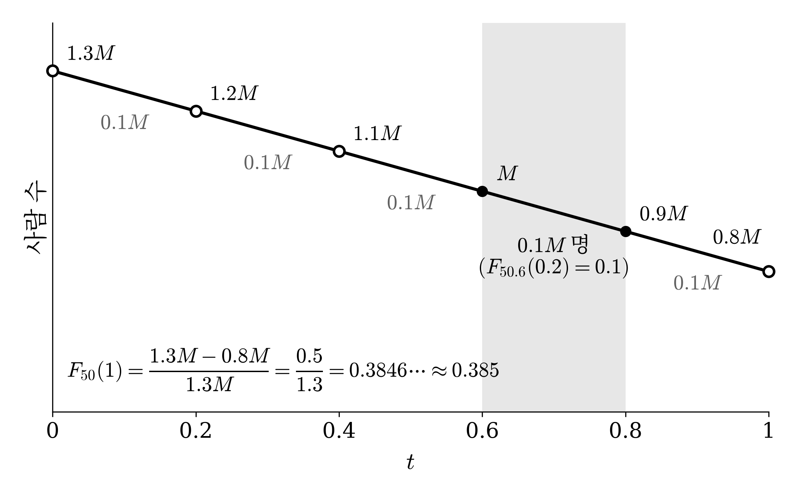
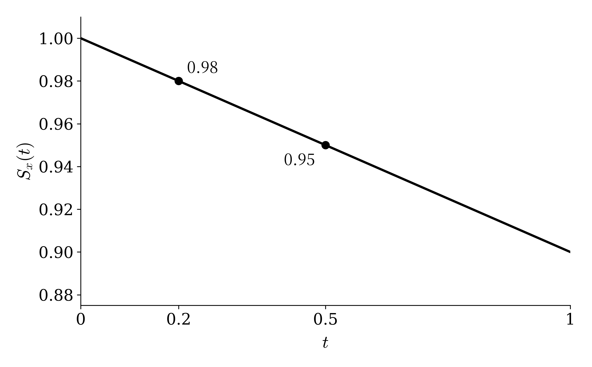
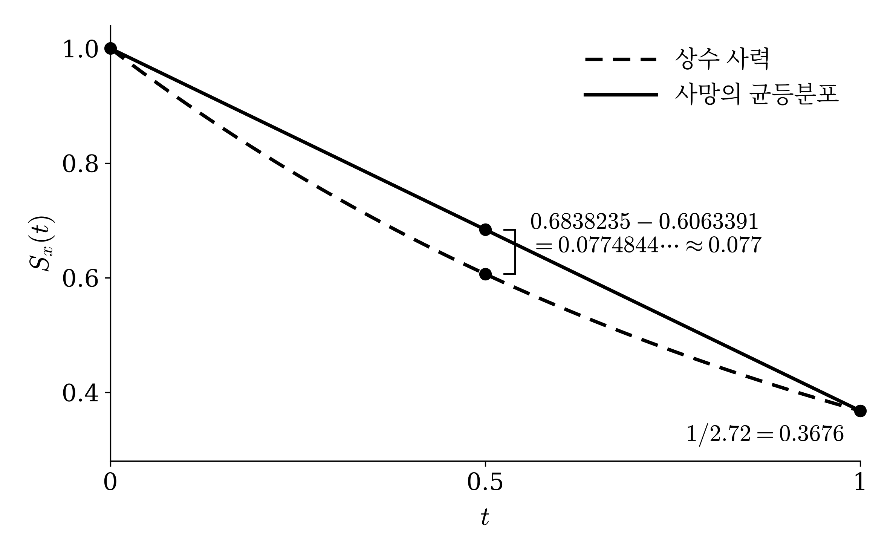
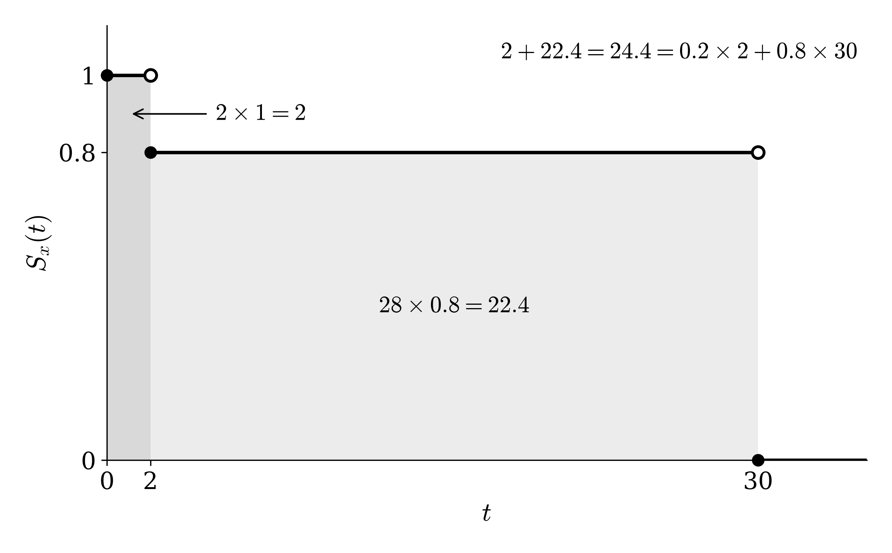
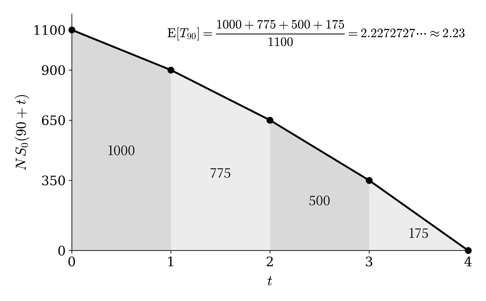

# 1. 강의영상



# 2. 생명표 (CFM, UDD)

## A. 개념

pass

## B. 기출문제

`# 예제 1 (2020 1차 39번)` 다음 두 조건을 만족하는 $F_{50}(1)$ 의 값을 구하시오.

::: {style="border: 1px solid #c8c8c8; padding: 16px 14px 0 14px; margin: 0.6em 0;"}
(가) $F_{50.6}(0.2) = 0.1$

(나) 연령 $[x, x+1)$ 에서 단수부분에 대해 사망자 수가 균등분포(UDD)를 따름
:::

① 0.370  ② 0.375  ③ 0.380  ④ 0.385

`(풀이1)` 구하는 것은 $F_{50}(1)$ 이고, 이것을 $q$ 라 하자. (가) 의 $F_{50.6}(0.2)$ 는 UDD 에서 $q$ 로 정해진다.

$$
\begin{aligned}
&F_{50.6}(0.2) = 1 - S_{50.6}(0.2) \\
&\quad = 1 - \frac{S_{50}(0.8)}{S_{50}(0.6)} \quad (\because S_{50}(0.8) = S_{50}(0.6)\,S_{50.6}(0.2)) \\
&\quad = 1 - \frac{1 - 0.8q}{1 - 0.6q} \quad (\because \text{UDD: } S_{50}(t) = 1 - t\,q) \\
&\quad = \frac{0.2q}{1 - 0.6q}
\end{aligned}
$$

(가) 에서 이것이 $0.1$ 이므로 $0.2q = 0.1 - 0.06q$, 곧 $0.26q = 0.1$ 이고 $q = \frac{0.1}{0.26} = 0.3846153\cdots \approx 0.385$.

`(풀이2)` 

{width=75% fig-align="center"}

답: ④ 0.385

::: {.callout-note collapse="true" title="실제 기출은 이러하다"}
다음 두 조건을 만족하는 $q_{50}$의 값을 구하시오.

::: {style="border: 1px solid #c8c8c8; padding: 16px 14px 0 14px; margin: 0.6em 0;"}
(가) ${}_{0.2}q_{50.6} = 0.1$

(나) 연령 $[x, x+1)$에서 단수부분에 대해 사망자 수가 균등분포(UDD)를 따름.
:::

① 0.370  ② 0.375  ③ 0.380  ④ 0.385

**시험지의 기호**

| 시험지 | 뜻 | 우리 기호 |
|----|----------|--------|
| ${}_tq_x$ | $x$ 세인 사람이 $t$ 년 안에 죽을 확률 | $F_x(t) = \Pr(T_x \le t)$ |
| $p_x$ · $q_x$ | 기간이 1년이면 왼쪽 아래첨자를 뗀다. $p_x = {}_1p_x$, $q_x = {}_1q_x$ | $S_x(1)$ · $F_x(1)$ |
| UDD | 사망의 균등분포(uniform distribution of deaths). 시험지에서는 단수부분에 대해 사망자수가 균등하게 분포한다는 가정이다 | $F_x(t) = t\,F_x(1)$ ($x$ 는 정수, $0 \le t \le 1$) |
:::

`#`

`# 예제 2 (2022 1차 28번)` $F_x(1) = 0.1$ 이고 UDD ($F_x(t) = t \cdot F_x(1)$, $x$ 는 정수, $0 \le t \le 1$) 를 가정할 때, $S_x(0.2) - S_x(0.5)$ 를 구하시오.

① 0.020  ② 0.025  ③ 0.030  ④ 0.035

`(풀이1)`

$$
\begin{aligned}
&S_x(0.2) - S_x(0.5) = \{1 - F_x(0.2)\} - \{1 - F_x(0.5)\} = F_x(0.5) - F_x(0.2) \\
&\quad = 0.5\,F_x(1) - 0.2\,F_x(1) \quad (\because \text{UDD}) \\
&\quad = 0.3 \times 0.1 = 0.03
\end{aligned}
$$

`(풀이2)`

{width=75% fig-align="center"}

답: ③ 0.030

::: {.callout-note collapse="true" title="실제 기출은 이러하다"}
$q_x = 0.1$ 이고 UDD (${}_tq_x = t \cdot q_x$, $x$ 는 정수, $0 \le t \le 1$) 를 가정할 때, ${}_{0.2\vert 0.3}q_x$ 를 구하시오.

① 0.020  ② 0.025  ③ 0.030  ④ 0.035

**시험지의 기호**

| 시험지 | 뜻 | 우리 기호 |
|----|----------|--------|
| ${}_tq_x$ | $x$ 세인 사람이 $t$ 년 안에 죽을 확률 | $F_x(t) = \Pr(T_x \le t)$ |
| $p_x$ · $q_x$ | 기간이 1년이면 왼쪽 아래첨자를 뗀다. $p_x = {}_1p_x$, $q_x = {}_1q_x$ | $S_x(1)$ · $F_x(1)$ |
| ${}_{u\vert t}q_x$ | $x$ 세인 사람이 $u$ 년은 살고 그다음 $t$ 년 안에 죽을 확률. $t = 1$ 이면 ${}_{u\vert}q_x$ 이다 | $S_x(u) - S_x(u+t) = \Pr(u < T_x \le u+t)$ |
:::

`#`

`# 예제 3 (2019 1차 38번)` 다음 조건 하에서 $F_x^{\text{CFM}}(0.5) - F_x^{\text{UDD}}(0.5)$ 를 구하시오. (단, $e = 2.72$)

::: {style="border: 1px solid #c8c8c8; padding: 10px 14px; margin: 0.6em 0;"}
(가) $x$ 는 정수 연령이고 $S_x(1) = e^{-1}$ \
(나) $F_x^{\text{CFM}}(t)$ 는 연령 $[x, x+1)$ 에서 단수 부분에 대해 사력이 일정하다(CFM)고 가정할 때 $(x)$ 가 $t$ 년 이내에 사망할 확률 \
(다) $F_x^{\text{UDD}}(t)$ 는 연령 $[x, x+1)$ 에서 단수 부분에 대해 사망자 수의 균등분포(UDD)를 가정할 때 $(x)$ 가 $t$ 년 이내에 사망할 확률
:::

① 0.055  ② 0.077  ③ 0.099  ④ 0.122

`(풀이1)` 구하는 것은 $F_x^{\text{CFM}}(0.5) - F_x^{\text{UDD}}(0.5)$ 이다. 둘은 각각 아래와 같다.

$$
\begin{aligned}
&F_x^{\text{CFM}}(0.5) = 1 - S_x(0.5) \\
&\quad = 1 - S_x(1)^{0.5} \quad (\because \text{CFM: } S_x(t) = S_x(1)^t) \\
&\quad = 1 - e^{-0.5} = 1 - \frac{1}{\sqrt{2.72}} = 0.3936609\cdots \quad (\because \text{(가)}, \ e = 2.72)
\end{aligned}
$$

$$
\begin{aligned}
&F_x^{\text{UDD}}(0.5) = 0.5\,F_x(1) \quad (\because \text{UDD: } F_x(t) = t\,F_x(1)) \\
&\quad = 0.5\,(1 - e^{-1}) = 0.5\left(1 - \frac{1}{2.72}\right) = 0.3161764\cdots \quad (\because \text{(가)})
\end{aligned}
$$

따라서 구하는 값은 $0.3936609\cdots - 0.3161764\cdots = 0.0774844\cdots \approx 0.077$.

`(풀이2)` 

{width=75% fig-align="center"}

답: ② 0.077

::: {.callout-note collapse="true" title="실제 기출은 이러하다"}
다음 조건 하에서 ${}_{0.5}q_x^{CFM} - {}_{0.5}q_x^{UDD}$를 구하시오. (단, $e = 2.72$)

::: {style="border: 1px solid #c8c8c8; padding: 10px 14px; margin: 0.6em 0;"}
(가) $x$는 정수 연령이고 $p_x = e^{-1}$ \
(나) ${}_tq_x^{CFM}$은 연령 $[x, x+1)$에서 단수 부분에 대해 사력이 일정하다(CFM)고 가정할 때 $(x)$가 $t$년 이내에 사망할 확률 \
(다) ${}_tq_x^{UDD}$는 연령 $[x, x+1)$에서 단수 부분에 대해 사망자 수의 균등분포(UDD)를 가정할 때 $(x)$가 $t$년 이내에 사망할 확률
:::

① 0.055  ② 0.077  ③ 0.099  ④ 0.122

**시험지의 기호**

| 시험지 | 뜻 | 우리 기호 |
|----|----------|--------|
| ${}_tq_x$ | $x$ 세인 사람이 $t$ 년 안에 죽을 확률 | $F_x(t) = \Pr(T_x \le t)$ |
| $p_x$ · $q_x$ | 기간이 1년이면 왼쪽 아래첨자를 뗀다. $p_x = {}_1p_x$, $q_x = {}_1q_x$ | $S_x(1)$ · $F_x(1)$ |
| UDD | 사망의 균등분포(uniform distribution of deaths). 시험지에서는 단수부분에 대해 사망자수가 균등하게 분포한다는 가정이다 | $F_x(t) = t\,F_x(1)$ ($x$ 는 정수, $0 \le t \le 1$) |
| CFM | 단수부분에 사력이 일정하다(constant force of mortality) | $S_x(t) = S_x(1)^t$ ($x$ 는 정수, $0 \le t \le 1$) |
:::

`#`

`# 예제 4 (2023 1차 35번)` 다음의 생명표에서 $S_{10}(2)$ 를 구하시오.

| $t$ | $N\,S_0(t)$ | $N\,(S_0(t) - S_0(t+1))$ | $\frac{S_0(t+1)}{S_0(t)}$ |
|---|---|---|---|
| 10 | | 70 | |
| 11 | | | 0.98 |
| 12 | 810 | | |

① 0.9219  ② 0.9175  ③ 0.9140  ④ 0.9035

`(풀이)` 구하는 것은 $S_{10}(2)$ 다.

$$
S_{10}(2) = \frac{N S_0(12)}{N S_0(10)} = \frac{810}{N S_0(10)} \qquad \left(\because S_{10}(2) = \frac{S_0(12)}{S_0(10)}\right)
$$

$N S_0(10)$ 은 표의 아래 줄부터 차례로 정해진다. 11세 줄의 $S_{11}(1) = 0.98$ 은 11세까지 산 사람 가운데 12세까지 사는 비율이다.

$$
\begin{aligned}
&N S_0(11) = \frac{N S_0(12)}{S_{11}(1)} = \frac{810}{0.98} = 826.5306\cdots \\
&N S_0(10) = N S_0(11) + N\,(S_0(10) - S_0(11)) = 826.5306\cdots + 70 = 896.5306\cdots
\end{aligned}
$$

따라서 $S_{10}(2) = \frac{810}{896.5306\cdots} = 0.9034828\cdots \approx 0.9035$.

답: ④ 0.9035

::: {.callout-note collapse="true" title="실제 기출은 이러하다"}
다음의 생명표에서 ${}_2p_{10}$ 을 구하시오.

| $x$ | $l_x$ | $d_x$ | $p_x$ |
|---|---|---|---|
| 10 | | 70 | |
| 11 | | | 0.98 |
| 12 | 810 | | |

① 0.9219  ② 0.9175  ③ 0.9140  ④ 0.9035

**시험지의 기호**

| 시험지 | 뜻 | 우리 기호 |
|----|----------|--------|
| ${}_tp_x$ | $x$ 세인 사람이 $t$ 년 뒤에도 살아 있을 확률 | $S_x(t) = \Pr(T_x > t)$ |
| $p_x$ · $q_x$ | 기간이 1년이면 왼쪽 아래첨자를 뗀다. $p_x = {}_1p_x$, $q_x = {}_1q_x$ | $S_x(1)$ · $F_x(1)$ |
| $l_x$ | 생명표(life table). 시작 나이 $x_0$ 의 사람 수 $l_{x_0}$ (기수, radix) 를 정하고 $l_{x_0+t} = l_{x_0}\,{}_tp_{x_0}$ 로 만든 함수다. $x$ 세인 $l_x$ 명 가운데 $x+t$ 세까지 살아 있을 사람 수의 기댓값이 $l_{x+t}$ 이다 | 시작 나이가 0 이면 $l_x = N\,S_0(x)$ ($N = l_0$). 언제나 $\frac{l_{x+t}}{l_x} = S_x(t)$ |
| $d_x$ | $x$ 세인 $l_x$ 명 가운데 1년 안에 죽을 사람 수의 기댓값. $d_x = l_x - l_{x+1} = l_x\,q_x$ | $N\,(S_0(x) - S_0(x+1))$ |
:::

`#`

# 3. 남은 수명의 평균

## A. 개념

`-` 아래의 표를 살펴보자.

| 남은 수명 $T_x$ | 2년 | 30년 |
|---|---|---|
| 확률 | 0.2 | 0.8 |

남은 수명 $T_x$ 의 분포는 아래와 같다.

$$\mathrm E[T_x] = 0.2 \times 2 + 0.8 \times 30 = 24.4$$

`-`  위의 표를 생존함수로 그린뒤 생존함수 아래의 넓이를 재면 아래와 같다.

{width=75% fig-align="center"}

`-` 일반화하면 아래가 성립한다. $$\mathrm E[T_x] = \int_0^\infty S_x(t)\,dt$$

`(증명)`  

$$
\begin{aligned}
&\mathrm E[T_x] = \int_0^\infty t\,F_x'(t)\,dt \\
&\quad = \int_0^\infty t\,\{-S_x'(t)\}\,dt \quad (\because F_x(t) = 1 - S_x(t)) \\
&\quad = \Big[-t\,S_x(t)\Big]_0^\infty + \int_0^\infty S_x(t)\,dt \quad (\because \text{부분적분}) \\
&\quad = \int_0^\infty S_x(t)\,dt \quad \left(\because \text{가정(assumption): } \lim_{t \to \infty} t\,S_x(t) = 0\right)
\end{aligned}
$$

## B. 기출문제

`# 예제 5 (2021 1차 27번)` 연령 $[x, x+1)$ 에서 단수부분에 대해 사망자 수가 균등하게 분포한다(UDD)고 가정할 때, 다음의 생명표를 이용하여 $\mathrm E[T_{90}]$ 을 구하시오.

| $t$ | 90 | 91 | 92 | 93 | 94 |
|---|---|---|---|---|---|
| $N S_0(t)$ | 1100 | 900 | 650 | 350 | 0 |

① 2.23  ② 2.57  ③ 2.83  ④ 3.12

`(풀이1)` 구하는 것은 $\mathrm E[T_{90}]$ 이다. 94세에 다 죽으므로 적분 구간은 0 ~ 4 년이다. UDD 면 정수 나이 사이에서 $S_{90}(k+t) = S_{90}(k)\,\{1 - t\,F_{90+k}(1)\}$ 가 $t$ 의 직선이라 한 해의 적분은 사다리꼴 넓이다. 표의 사람 수로는 $S_{90}(k) = \frac{N S_0(90+k)}{N S_0(90)} = \frac{N S_0(90+k)}{1100}$ 이다.

$$
\begin{aligned}
&\mathrm E[T_{90}] = \int_0^4 S_{90}(t)\,dt = \sum_{k=0}^{3} \int_k^{k+1} S_{90}(t)\,dt \\
&\quad = \sum_{k=0}^{3} \frac{S_{90}(k) + S_{90}(k+1)}{2} \quad (\because \text{UDD — 사다리꼴 넓이}) \\
&\quad = \frac{1}{1100}\left(\frac{1100 + 900}{2} + \frac{900 + 650}{2} + \frac{650 + 350}{2} + \frac{350 + 0}{2}\right) \\
&\quad = \frac{1000 + 775 + 500 + 175}{1100} = 2.2272727\cdots \approx 2.23
\end{aligned}
$$

`(풀이2)` 

{width=75% fig-align="center"}

답: ① 2.23

::: {.callout-note collapse="true" title="실제 기출은 이러하다"}
연령 $[x, x+1)$에서 단수부분에 대해 사망자 수가 균등하게 분포한다(UDD)고 가정할 때, 다음의 생명표를 이용하여 $\mathring e_{90}$을 구하시오.

| $x$ | 90 | 91 | 92 | 93 | 94 |
|---|---|---|---|---|---|
| $l_x$ | 1100 | 900 | 650 | 350 | 0 |

① 2.23  ② 2.57  ③ 2.83  ④ 3.12

**시험지의 기호**

| 시험지 | 뜻 | 우리 기호 |
|----|----------|--------|
| $\mathring e_x$ | 완전기대여명(complete expectation of life). 남은 수명의 평균 | $\mathrm E[T_x] = \int_0^\infty S_x(t)\,dt$ |
| $l_x$ | 생명표(life table). 시작 나이 $x_0$ 의 사람 수 $l_{x_0}$ (기수, radix) 를 정하고 $l_{x_0+t} = l_{x_0}\,{}_tp_{x_0}$ 로 만든 함수다. $x$ 세인 $l_x$ 명 가운데 $x+t$ 세까지 살아 있을 사람 수의 기댓값이 $l_{x+t}$ 이다 | 시작 나이가 0 이면 $l_x = N\,S_0(x)$ ($N = l_0$). 언제나 $\frac{l_{x+t}}{l_x} = S_x(t)$ |
| UDD | 사망의 균등분포(uniform distribution of deaths). 시험지에서는 단수부분에 대해 사망자수가 균등하게 분포한다는 가정이다 | $F_x(t) = t\,F_x(1)$ ($x$ 는 정수, $0 \le t \le 1$) |
:::

`#`
