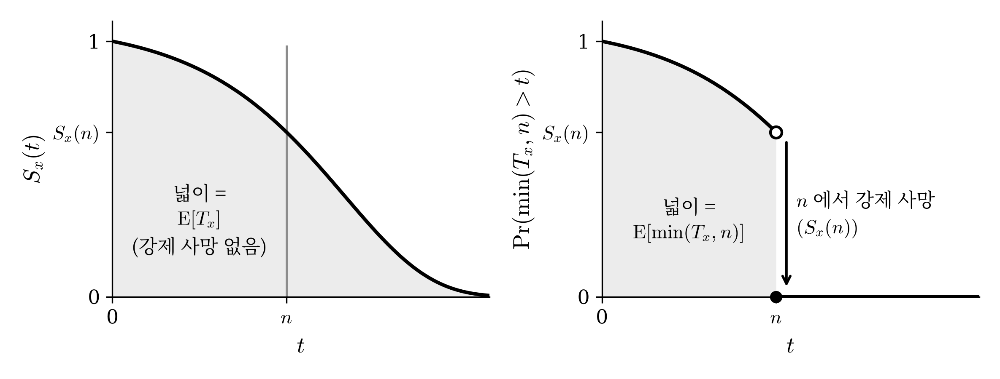
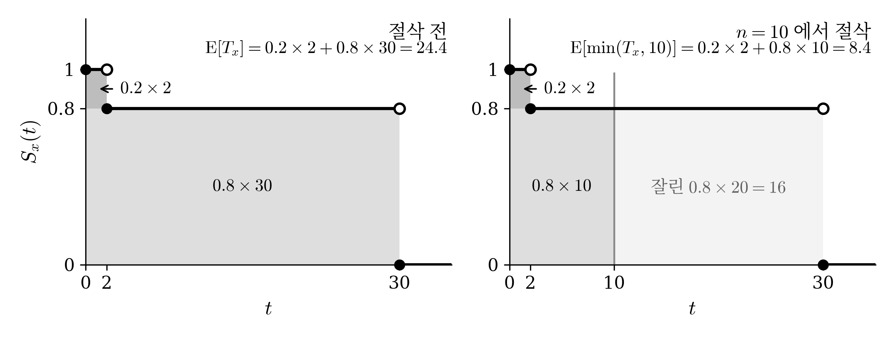
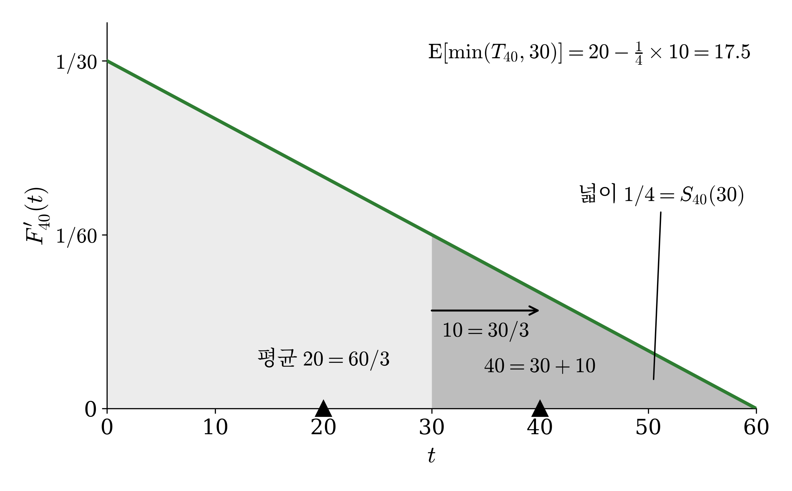
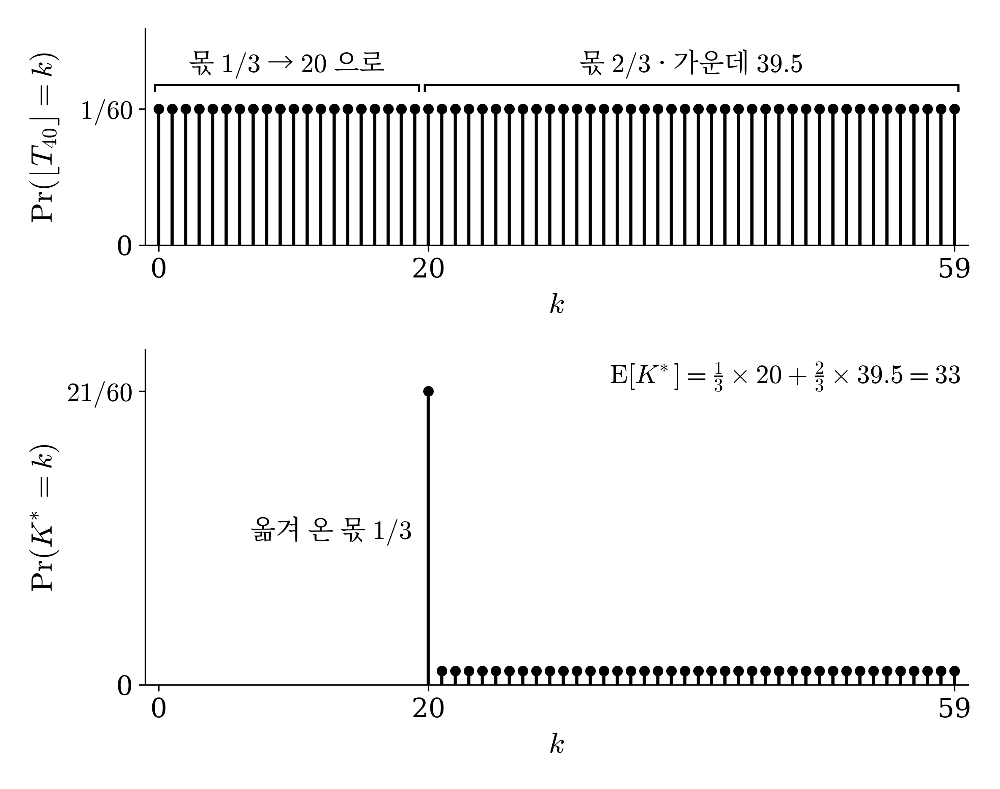
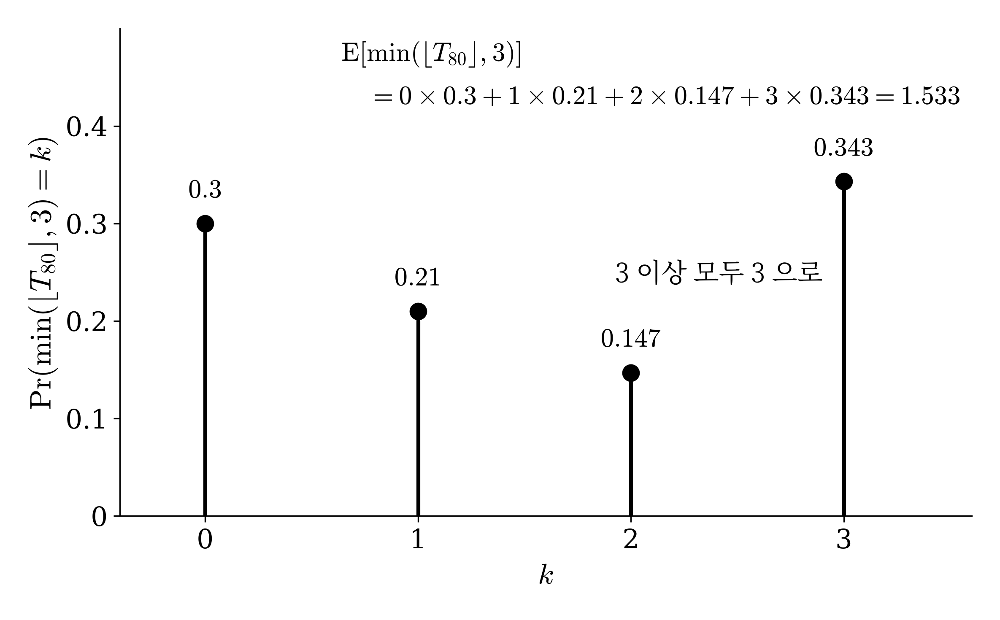

# 1. 강의영상



# 2. CFM, UDD

## A. 개념

pass

## B. 기출문제

`# 예제 1 (2026 1차 29번)` 아래의 조건을 이용하여 60세의 사람이 60.2세에서 60.9세 사이에 사망할 확률을 구하시오.

::: {style="border: 1px solid #c8c8c8; padding: 10px 14px; margin: 0.6em 0;"}
(가) UDD($F_x(t) = t\,F_x(1)$, $x$ 는 정수, $0 \le t \le 1$)를 가정함 \
(나) $N\,S_0(60) = 2000$, $N\,(S_0(60) - S_0(61)) = 80$
:::

① 0.020  ② 0.024  ③ 0.028  ④ 0.032

`(풀이)` 구하는 것은 60세인 사람이 60.2세와 60.9세 사이에 죽을 확률 $\Pr(0.2 < T_{60} \le 0.9)$ 이다. UDD 로 세려면 $F_{60}(1)$ 이 필요한데,

$$
\begin{aligned}
&F_{60}(1) = 1 - S_{60}(1) \\
&\quad = 1 - \frac{S_0(61)}{S_0(60)} \quad \left(\because S_x(t) = \frac{S_0(x+t)}{S_0(x)}\right) \\
&\quad = \frac{N\,(S_0(60) - S_0(61))}{N\,S_0(60)} \\
&\quad = \frac{80}{2000} = 0.04
\end{aligned}
$$

이다. UDD 에서는

$$
\begin{aligned}
&\Pr(0.2 < T_{60} \le 0.9) = S_{60}(0.2) - S_{60}(0.9) \\
&\quad = F_{60}(0.9) - F_{60}(0.2) \quad (\because S_x(t) = 1 - F_x(t)) \\
&\quad = 0.9\,F_{60}(1) - 0.2\,F_{60}(1) \quad (\because F_x(t) = t\,F_x(1)) \\
&\quad = 0.7 \times 0.04 = 0.028
\end{aligned}
$$

이다. 따라서 구하는 값은 0.028 이다.

답: ③ (0.028)

::: {.callout-note collapse="true" title="실제 기출은 이러하다"}
아래의 조건을 이용하여 60세의 사람이 60.2세에서 60.9세 사이에 사망할 확률을 구하시오.

::: {style="border: 1px solid #c8c8c8; padding: 10px 14px; margin: 0.6em 0;"}
(가) UDD(${}_tq_x = t \cdot q_x$, $x$ 는 정수, $0 \le t \le 1$)를 가정함 \
(나) $l_{60} = 2000$, $d_{60} = 80$
:::

① 0.020  ② 0.024  ③ 0.028  ④ 0.032

**시험지의 기호**

| 시험지 | 뜻 | 우리 기호 |
|----|----------|--------|
| ${}_tq_x$ | $x$ 세인 사람이 $t$ 년 안에 죽을 확률 | $F_x(t) = \Pr(T_x \le t)$ |
| $p_x$ · $q_x$ | 기간이 1년이면 왼쪽 아래첨자를 뗀다. $p_x = {}_1p_x$, $q_x = {}_1q_x$ | $S_x(1)$ · $F_x(1)$ |
| $l_x$ | 생명표(life table). 시작 나이 $x_0$ 의 사람 수 $l_{x_0}$ (기수, radix) 를 정하고 $l_{x_0+t} = l_{x_0}\,{}_tp_{x_0}$ 로 만든 함수다. $x$ 세인 $l_x$ 명 가운데 $x+t$ 세까지 살아 있을 사람 수의 기댓값이 $l_{x+t}$ 이다 | 시작 나이가 0 이면 $l_x = N\,S_0(x)$ ($N = l_0$). 언제나 $\frac{l_{x+t}}{l_x} = S_x(t)$ |
| $d_x$ | $x$ 세인 $l_x$ 명 가운데 1년 안에 죽을 사람 수의 기댓값. $d_x = l_x - l_{x+1} = l_x\,q_x$ | $N\,(S_0(x) - S_0(x+1))$ |
:::

`#`

# 3. $\min(T_x,n)$

## A. 개념

`-` 남은수명을 $T_x$에서 $\min(T_x,n)$으로 바꾸는 경우가 종종 있다. 이것은 (1) $n$년 이전까지는 본래 수명 $T_x$까지 살게 내버려 두고 (2) $n$년 이후에는 강제로 사망시키는 개념이라 생각하면 된다. (조금 과격하지만.. 이해를 위해서) 

`-` 사실 이러한 수식은 양로보험에서 잘 등장한다. 양로보험은 (1) $n$년 안에 죽으면 죽는 순간 주고, (2) $n$년을 넘겨 살면 $n$년 뒤에 주는 보험인데(어느 쪽이든 한 번은 준다), 여기에서 (2)의 경우 그냥 $n$년에 강제로 사망 처리한 뒤 보험금을 지급한다고 생각하면 편리하다. 

`-` 따라서 원래 생존함수를 $n$ 에서 자르는 느낌이라 보면 된다.

{width=100% fig-align="center"}

`-` 평균은 아래와 같이 계산한다. 

$$\mathrm E[\min(T_x, n)] = \int_0^n S_x(t)\,dt$$

`-` 이해를 위하여 다시 아래의 예제를 살펴보자.

| 남은 수명 $T_x$ | 2년 | 30년 |
|---|---|---|
| 확률 | 0.2 | 0.8 |

$n = 10$ 년까지만 세면 2년에 죽는 사람은 2년, 30년 사는 사람은 10년으로 세야 한다. 

$$\mathrm E[\min(T_x, 10)] = 0.2 \times 2 + 0.8 \times 10 = 8.4$$

위의 표를 생존함수로 그린 뒤 $0 \sim 10$ 넓이를 재면 아래와 같다.

{width=100% fig-align="center"}

## B. 기출문제

`# 예제 2 (2026 1차 28번)` 사력이 $\mu_0(t) = \frac{2}{100 - t}$, $0 \le t < 100$ 일 때, $\mathrm E[\min(T_{40}, 30)]$ 을 구하시오.

① 16.5  ② 17.5  ③ 18.5  ④ 19.5

`(풀이1)` 구하는 것은 $\mathrm E[\min(T_{40}, 30)] = \int_0^{30} S_{40}(t)\,dt$ 이다. 사력은 갓난아기의 사력 $\mu_0$ 로 주어졌지만 $S_{40}(t)$ 에 필요한 것은 40세인 사람의 사력 $\mu_{40}(t)$ 이다.

$$
\begin{aligned}
&S_{40}(t) = \exp\left\{-\int_0^t \mu_{40}(s)\,ds\right\} \\
&\quad = \exp\left\{-\int_0^t \mu_0(40+s)\,ds\right\} \quad (\because \mu_x(t) = \mu_0(x+t)) \\
&\quad = \exp\left\{-\int_0^t \frac{2}{60 - s}\,ds\right\} \quad \left(\because \mu_0(t) = \frac{2}{100 - t}\right) \\
&\quad = \exp\left\{2\log\frac{60 - t}{60}\right\} = \left(\frac{60 - t}{60}\right)^2
\end{aligned}
$$

$$
\begin{aligned}
&\mathrm E[\min(T_{40}, 30)] = \int_0^{30} \left(\frac{60 - t}{60}\right)^2 dt \\
&\quad = \frac{1}{60^2}\left[-\frac{(60 - t)^3}{3}\right]_0^{30} = \frac{60^3 - 30^3}{3 \times 60^2} = 17.5
\end{aligned}
$$

`(풀이2)` 사력이 만약에 $\mu_0(t)=\frac{1}{100 - t}$ 이면 case2 에서 $a = 100$ 인 꼴이라 $S_0(t)=1 - \frac{t}{100}$ 이다. 따라서 $S_{40}(t)=1-\frac{t}{60}$이다. 문제에서 준 사력은 $\mu_0(t)=\frac{2}{100-t}$ 이므로 우리가 원했던 사력의 2배이다. 그런데 사력이 2배면 넓이가 2배이고, 그래서 생존함수는 제곱이라는 사실을 떠올리면 

$$S_{40}(t) = \left(1 - \frac{t}{60}\right)^2$$
임을 알 수 있다. 생존함수가 $\left(1 - \frac{t}{60}\right)^2$ 이면 히스토그램 $F_{40}'(t) = \frac{2(60 - t)}{60^2}$ 은 $t = 0$ 에서 가장 높고 $t = 60$ 에서 0 인 직각삼각형이다(삼각분포). $T_{40}/60$ 의 히스토그램은 $2(1 - u)$, $0 \le u \le 1$ 이라 $\mathrm{Beta}(1, 2)$ 분포이고, 이는 균등분포 둘의 최솟값의 분포와 같다(위키백과 Order statistic). $\mathrm{Beta}(1, 2)$ 는 왼쪽에 직각이 있는 직각삼각형 분포이고(위키백과 Beta distribution), $\mathrm{Beta}(\alpha, \beta)$ 의 평균은 $\frac{\alpha}{\alpha + \beta}$ 이므로 $\mathrm E[T_{40}] = 60 \times \frac{1}{3} = 20$ 이다. $\min(T_{40}, 30)$ 은 30년 넘게 사는 사람의 30년 뒤를 잘라 낸 것이다. 30년 넘게 사는 사람은 $S_{40}(30) = \frac14$ 이고, 이들은 70세에서 사력이 $\mu_{70}(t) = \frac{2}{30 - t}$ 라 $S_{70}(t) = \left(1 - \frac{t}{30}\right)^2$ 이고, 같은 이유로 $T_{70}/30$ 도 $\mathrm{Beta}(1, 2)$ 라 평균 $30 \times \frac{1}{3} = 10$ 년을 더 산다.

{width=75% fig-align="center"}

$$\mathrm E[\min(T_{40}, 30)] = \mathrm E[T_{40}] - S_{40}(30)\,\mathrm E[T_{70}] = 20 - \frac14 \times 10 = 17.5$$

답: ② 17.5

::: {.callout-note collapse="true" title="실제 기출은 이러하다"}
사력이 $\mu_t = \frac{2}{100 - t}$, $0 \le t < 100$ 일 때, $\mathring e_{40:\overline{30}\vert}$ 을 구하시오.

① 16.5  ② 17.5  ③ 18.5  ④ 19.5

**시험지의 기호**

| 시험지 | 뜻 | 우리 기호 |
|----|----------|--------|
| $\mu_x$ | $x$ 세의 사력(force of mortality). $\mu_x = \lim_{h \to 0+} \frac{1}{h}\Pr(T_0 \le x+h \mid T_0 > x)$ | $\mu_0(t) = -\frac{d}{dt}\log S_0(t)$ |
| $\mathring e_{x:\overline{n}\vert}$ | $n$ 년 정기완전평균여명. 남은 수명을 $n$ 년까지만 센 평균 | $\mathrm E[\min(T_x, n)] = \int_0^n S_x(t)\,dt$ |
:::

`#`

# 4. $\lfloor T_x \rfloor$ 

## A. 개념

`-` $\lfloor T_x \rfloor$ 기호의 의미: $T_x$ 의 정수 부분,

- 예: 0세인 사람이 60.2살에 죽으면 $T_0 = 60.2$ 이고 $\lfloor T_0 \rfloor = 60$ 이다. 60.9살에 죽어도 $\lfloor T_0 \rfloor = 60$ 이다.

## B. 기출문제

`# 예제 3 (2024 1차 32번)` 아래의 조건을 이용하여 $\mathrm E[K^*]$ 를 구하시오.

::: {style="border: 1px solid #c8c8c8; padding: 10px 14px; margin: 0.6em 0;"}
(가) $S_0(t) = 1 - \frac{t}{100}$, $0 \le t \le 100$ \
(나) $\lfloor T_{40} \rfloor$ 은 $T_{40}$ 의 정수 부분을 나타내는 확률변수임 \
(다) $K^* = \begin{cases} 20, & \lfloor T_{40} \rfloor = 0, 1, \ldots, 19 \\ \lfloor T_{40} \rfloor, & \lfloor T_{40} \rfloor = 20, 21, 22, \ldots \end{cases}$
:::

① 33  ② 34  ③ 35  ④ 36

`(풀이)` 구하는 것은 $\mathrm E[K^*]$ 이다. $K^*$ 는 $\lfloor T_{40} \rfloor$ 로 정해지므로 $\lfloor T_{40} \rfloor$ 의 분포가 필요하다.

$$
\begin{aligned}
&S_{40}(t) = \frac{S_0(40+t)}{S_0(40)} \quad \left(\because S_x(t) = \frac{S_0(x+t)}{S_0(x)}\right) \\
&\quad = \frac{1 - (40+t)/100}{1 - 40/100} = 1 - \frac{t}{60}, \quad 0 \le t \le 60
\end{aligned}
$$

$$
\begin{aligned}
&\Pr(\lfloor T_{40} \rfloor = k) = S_{40}(k) - S_{40}(k+1) \quad (\because \Pr(\lfloor T_x \rfloor = k) = S_x(k) - S_x(k+1)) \\
&\quad = \frac{1}{60}, \quad k = 0, 1, \ldots, 59
\end{aligned}
$$

(다) 대로 $\lfloor T_{40} \rfloor$ 이 0 ~ 19 이면 $K^* = 20$ 이고, 20 이상이면 $K^* = \lfloor T_{40} \rfloor$ 이다.

$$
\begin{aligned}
&\mathrm E[K^*] = \sum_{k=0}^{19} 20 \times \frac{1}{60} + \sum_{k=20}^{59} k \times \frac{1}{60} \\
&\quad = \frac{400 + 1580}{60} = 33 \quad \left(\because \sum_{k=20}^{59} k = \frac{(20 + 59) \times 40}{2} = 1580\right)
\end{aligned}
$$

`(풀이2)`

{width=75% fig-align="center"}

답: ① 33

::: {.callout-note collapse="true" title="실제 기출은 이러하다"}
아래의 조건을 이용하여 $E[K^*]$를 구하시오.

::: {style="border: 1px solid #c8c8c8; padding: 10px 14px; margin: 0.6em 0;"}
(가) $l_x = 100-x,\ 0 \le x \le 100$ \
(나) $K(40)$은 40세인 사람의 장래개산생존기간(curtate future lifetime)을 나타내는 확률변수임 \
(다) $K^* = \begin{cases} 20, & K(40) = 0, 1, \ldots, 19 \\ K(40), & K(40) = 20, 21, 22, \ldots \end{cases}$
:::

① 33  ② 34  ③ 35  ④ 36

**시험지의 기호**

| 시험지 | 뜻 | 우리 기호 |
|----|----------|--------|
| $K_x$ · $K(x)$ | 장래개산생존기간(curtate future lifetime). $T_x$ 의 정수 부분 | $\lfloor T_x \rfloor$ |
| $E$ · $Var$ | 평균 · 분산 | $\mathrm E$ · $\mathrm V$ |
| $l_x$ | 생명표(life table). 시작 나이 $x_0$ 의 사람 수 $l_{x_0}$ (기수, radix) 를 정하고 $l_{x_0+t} = l_{x_0}\,{}_tp_{x_0}$ 로 만든 함수다. $x$ 세인 $l_x$ 명 가운데 $x+t$ 세까지 살아 있을 사람 수의 기댓값이 $l_{x+t}$ 이다 | 시작 나이가 0 이면 $l_x = N\,S_0(x)$ ($N = l_0$). 언제나 $\frac{l_{x+t}}{l_x} = S_x(t)$ |
:::

`#`

`# 예제 4 (2019 1차 29번)` 모든 나이 $x$ 에 대하여 사망률 $F_x(1) = 0.3$ 이다. 나이가 80세인 사람의 3년 정기개산미래생존기간(3-year temporary curtate future lifetime) $\min(\lfloor T_{80} \rfloor, 3)$ 의 분산을 구하시오.

① 0.94  ② 1.12  ③ 1.36  ④ 1.53

`(풀이)` 구하는 것은 $\mathrm V[\min(\lfloor T_{80} \rfloor, 3)]$ 이다. $Y = \min(\lfloor T_{80} \rfloor, 3)$ 이라 하자. 모든 나이에서 $S_x(1) = 1 - 0.3 = 0.7$ 이므로 $S_{80}(k) = S_{80}(1)\,S_{81}(1) \cdots S_{79+k}(1) = 0.7^k$ 이고, $Y$ 의 분포는

$$
\begin{aligned}
&\Pr(Y = 0) = 1 - S_{80}(1) = 0.3 \\
&\Pr(Y = 1) = S_{80}(1) - S_{80}(2) = 0.7 - 0.49 = 0.21 \\
&\Pr(Y = 2) = S_{80}(2) - S_{80}(3) = 0.49 - 0.343 = 0.147 \\
&\Pr(Y = 3) = S_{80}(3) = 0.343 \quad (\because \lfloor T_{80} \rfloor \ge 3 \text{ 이면 } Y = 3)
\end{aligned}
$$

이다. $Y$ 의 확률분포표는 아래와 같다.

| $\lfloor T_{80} \rfloor$ | 0 | 1 | 2 | 3 이상 |
|---|---|---|---|---|
| $Y$ | 0 | 1 | 2 | 3 |
| 확률 | 0.3 | 0.21 | 0.147 | 0.343 |

$$
\begin{aligned}
&\mathrm E[Y] = 1 \times 0.21 + 2 \times 0.147 + 3 \times 0.343 = 1.533 \\
&\mathrm E[Y^2] = 1 \times 0.21 + 4 \times 0.147 + 9 \times 0.343 = 3.885 \\
&\mathrm V[Y] = \mathrm E[Y^2] - (\mathrm E[Y])^2 = 3.885 - 1.533^2 = 1.534911 \approx 1.53
\end{aligned}
$$

답: ④ 1.53

::: {.callout-note collapse="true" title="실제 기출은 이러하다"}
모든 나이 $x$에 대하여 사망률 $q_x = 0.3$이다. 나이가 80세인 사람의 3년 정기개산미래생존기간(3-year temporary curtate future lifetime) $\min(K_{80}, 3)$의 분산을 구하시오.

① 0.94  ② 1.12  ③ 1.36  ④ 1.53

**시험지의 기호**

| 시험지 | 뜻 | 우리 기호 |
|----|----------|--------|
| $p_x$ · $q_x$ | 기간이 1년이면 왼쪽 아래첨자를 뗀다. $p_x = {}_1p_x$, $q_x = {}_1q_x$ | $S_x(1)$ · $F_x(1)$ |
| $K_x$ · $K(x)$ | 장래개산생존기간(curtate future lifetime). $T_x$ 의 정수 부분 | $\lfloor T_x \rfloor$ |
:::

`#`

`# 예제 5 (2026 1차 27번)` 아래의 조건을 이용하여 $\mathrm V[X]$ 를 구하시오.

::: {style="border: 1px solid #c8c8c8; padding: 10px 14px; margin: 0.6em 0;"}
(가) $\lfloor T_x \rfloor$ 은 $x$ 세인 사람의 장래개산생존기간(curtate future lifetime)을 나타내는 확률변수임 \
(나) $F_x(1) = 0.1$, $F_{x+1}(1) = 0.2$, $F_{x+3}(1) = 0.3$ \
(다) $X = \min(\lfloor T_x \rfloor, 2)$
:::

① 0.3621  ② 0.3946  ③ 0.4172  ④ 0.4356

`(풀이)` 구하는 것은 $\mathrm V[X]$ 이다. $X = \min(\lfloor T_x \rfloor, 2)$ 는 $\lfloor T_x \rfloor$ 로 정해지므로 $X$ 의 분포는

$$
\begin{aligned}
&\Pr(X = 0) = \Pr(\lfloor T_x \rfloor = 0) = F_x(1) = 0.1 \\
&\Pr(X = 1) = \Pr(\lfloor T_x \rfloor = 1) = S_x(1) - S_x(2) \quad (\because \Pr(\lfloor T_x \rfloor = k) = S_x(k) - S_x(k+1)) \\
&\quad = S_x(1)\,F_{x+1}(1) \quad (\because S_x(2) = S_x(1)\,S_{x+1}(1)) \\
&\quad = 0.9 \times 0.2 = 0.18 \quad (\because S_x(1) = 1 - 0.1 = 0.9) \\
&\Pr(X = 2) = \Pr(\lfloor T_x \rfloor \ge 2) = S_x(2) \\
&\quad = S_x(1)\,S_{x+1}(1) \\
&\quad = 0.9 \times 0.8 = 0.72 \quad (\because S_{x+1}(1) = 1 - 0.2 = 0.8)
\end{aligned}
$$

이다. $\lfloor T_x \rfloor \ge 2$ 이면 모두 $X = 2$ 로 세므로 $F_{x+3}(1)$ 은 필요 없다.

$$
\begin{aligned}
&\mathrm E[X] = 1 \times 0.18 + 2 \times 0.72 = 1.62 \\
&\mathrm E[X^2] = 1 \times 0.18 + 4 \times 0.72 = 3.06 \\
&\mathrm V[X] = \mathrm E[X^2] - (\mathrm E[X])^2 \\
&\quad = 3.06 - 1.62^2 = 0.4356
\end{aligned}
$$

따라서 구하는 값은 0.4356 이다.

답: ④ (0.4356)

::: {.callout-note collapse="true" title="실제 기출은 이러하다"}
아래의 조건을 이용하여 $Var(X)$ 를 구하시오.

::: {style="border: 1px solid #c8c8c8; padding: 10px 14px; margin: 0.6em 0;"}
(가) $K(x)$ 는 $x$ 세인 사람의 장래개산생존기간(curtate future lifetime)을 나타내는 확률변수임 \
(나) $q_x = 0.1$, $q_{x+1} = 0.2$, $q_{x+3} = 0.3$ \
(다) $X = \min(K, 2)$
:::

① 0.3621  ② 0.3946  ③ 0.4172  ④ 0.4356

**시험지의 기호**

| 시험지 | 뜻 | 우리 기호 |
|----|----------|--------|
| $p_x$ · $q_x$ | 기간이 1년이면 왼쪽 아래첨자를 뗀다. $p_x = {}_1p_x$, $q_x = {}_1q_x$ | $S_x(1)$ · $F_x(1)$ |
| $K_x$ · $K(x)$ | 장래개산생존기간(curtate future lifetime). $T_x$ 의 정수 부분 | $\lfloor T_x \rfloor$ |
| $E$ · $Var$ | 평균 · 분산 | $\mathrm E$ · $\mathrm V$ |
:::

`#`

`# 예제 6 (2024 1차 30번)` 아래의 생명표를 이용하여 $\mathrm E[\min(\lfloor T_{40} \rfloor, 2)]$ 를 구하시오.

| $t$ | $N\,S_0(t)$ | $N\,(S_0(t) - S_0(t+1))$ | $1 - \frac{S_0(t+1)}{S_0(t)}$ | $\frac{S_0(t+1)}{S_0(t)}$ |
|---|---|---|---|---|
| 40 | 1000 | | | |
| 41 | | | 0.1 | |
| 42 | | 171 | | |
| 43 | 684 | | | |

① 1.705  ② 1.765  ③ 1.805  ④ 1.855

`(풀이)` 구하는 것은 $\mathrm E[\min(\lfloor T_{40} \rfloor, 2)]$ 이다.

$$
\begin{aligned}
&\mathrm E[\min(\lfloor T_{40} \rfloor, 2)] = S_{40}(1) + S_{40}(2) \quad \left(\because \mathrm E[\min(\lfloor T_x \rfloor, n)] = \sum_{k=1}^{n} S_x(k)\right) \\
&\quad = \frac{N S_0(41) + N S_0(42)}{N S_0(40)} \quad \left(\because S_{40}(k) = \frac{S_0(40+k)}{S_0(40)}\right)
\end{aligned}
$$

따라서 $N S_0(41)$ 과 $N S_0(42)$ 가 필요하고, 둘은 43세 줄에서 거슬러 올라가면 나온다. 42세 줄의 $N\,(S_0(42) - S_0(43)) = 171$ 은 42세에서 1년 안에 죽는 사람 수다.

$$
\begin{aligned}
&N S_0(42) = N S_0(43) + N\,(S_0(42) - S_0(43)) = 684 + 171 = 855 \\
&N S_0(41) = \frac{N S_0(42)}{S_{41}(1)} = \frac{855}{1 - 0.1} = 950 \quad \left(\because S_{41}(1) = \frac{S_0(42)}{S_0(41)} = 1 - F_{41}(1)\right)
\end{aligned}
$$

따라서 $\mathrm E[\min(\lfloor T_{40} \rfloor, 2)] = \frac{950 + 855}{1000} = 1.805$.

답: ③ 1.805

::: {.callout-note collapse="true" title="실제 기출은 이러하다"}
아래의 생명표를 이용하여 $e_{40:\overline{2}\vert}$를 구하시오.

| $x$ | $l_x$ | $d_x$ | $q_x$ | $p_x$ |
|---|---|---|---|---|
| 40 | 1000 | | | |
| 41 | | | 0.1 | |
| 42 | | 171 | | |
| 43 | 684 | | | |

① 1.705  ② 1.765  ③ 1.805  ④ 1.855

**시험지의 기호**

| 시험지 | 뜻 | 우리 기호 |
|----|----------|--------|
| $p_x$ · $q_x$ | 기간이 1년이면 왼쪽 아래첨자를 뗀다. $p_x = {}_1p_x$, $q_x = {}_1q_x$ | $S_x(1)$ · $F_x(1)$ |
| $e_{x:\overline{n}\vert}$ | $\lfloor T_x \rfloor$ 를 $n$ 년까지만 센 평균 | $\mathrm E[\min(\lfloor T_x \rfloor, n)] = \sum_{k=1}^{n} S_x(k)$ |
| $l_x$ | 생명표(life table). 시작 나이 $x_0$ 의 사람 수 $l_{x_0}$ (기수, radix) 를 정하고 $l_{x_0+t} = l_{x_0}\,{}_tp_{x_0}$ 로 만든 함수다. $x$ 세인 $l_x$ 명 가운데 $x+t$ 세까지 살아 있을 사람 수의 기댓값이 $l_{x+t}$ 이다 | 시작 나이가 0 이면 $l_x = N\,S_0(x)$ ($N = l_0$). 언제나 $\frac{l_{x+t}}{l_x} = S_x(t)$ |
| $d_x$ | $x$ 세인 $l_x$ 명 가운데 1년 안에 죽을 사람 수의 기댓값. $d_x = l_x - l_{x+1} = l_x\,q_x$ | $N\,(S_0(x) - S_0(x+1))$ |
:::

`#`

`# 예제 7 (2019 1차 28번)` 모든 나이 $x$ 에 대하여 사망률 $F_x(1) = 0.3$ 이다. 나이가 80세인 사람의 3년 정기개산평균여명(3-year temporary curtate expected future lifetime) $\mathrm E[\min(\lfloor T_{80} \rfloor, 3)]$ 을 구하시오.

① 1.53  ② 1.67  ③ 1.81  ④ 1.95

`(풀이1)` 구하는 것은 $\mathrm E[\min(\lfloor T_{80} \rfloor, 3)]$ 이다. 모든 나이에서 $S_x(1) = 1 - 0.3 = 0.7$ 이다.

$\min(\lfloor T_{80} \rfloor, 3)$ 의 확률분포표는 아래와 같다. $\Pr(\lfloor T_{80} \rfloor = k) = S_{80}(k) - S_{80}(k+1) = 0.7^k \times 0.3$ 이고, 3 이상은 모두 3 으로 센다.

| $\lfloor T_{80} \rfloor$ | 0 | 1 | 2 | 3 이상 |
|---|---|---|---|---|
| $\min(\lfloor T_{80} \rfloor, 3)$ | 0 | 1 | 2 | 3 |
| 확률 | 0.3 | 0.21 | 0.147 | 0.343 |

$$
\begin{aligned}
&\mathrm E[\min(\lfloor T_{80} \rfloor, 3)] = \sum_{k=1}^{3} S_{80}(k) \quad \left(\because \mathrm E[\min(\lfloor T_x \rfloor, n)] = \sum_{k=1}^{n} S_x(k)\right) \\
&\quad = 0.7 + 0.7^2 + 0.7^3 \quad (\because S_{80}(k) = S_{80}(1)\,S_{81}(1) \cdots S_{79+k}(1) = 0.7^k) \\
&\quad = 0.7 + 0.49 + 0.343 = 1.533 \approx 1.53
\end{aligned}
$$

표로 직접 평균을 내도 $0 \times 0.3 + 1 \times 0.21 + 2 \times 0.147 + 3 \times 0.343 = 1.533$ 이다.

`(풀이2)`

{width=75% fig-align="center"}

답: ① 1.53

::: {.callout-note collapse="true" title="실제 기출은 이러하다"}
모든 나이 $x$에 대하여 사망률 $q_x = 0.3$이다. 나이가 80세인 사람의 3년 정기개산평균여명(3-year temporary curtate expected future lifetime) $e_{80:\overline{3}\vert}$을 구하시오.

① 1.53  ② 1.67  ③ 1.81  ④ 1.95

**시험지의 기호**

| 시험지 | 뜻 | 우리 기호 |
|----|----------|--------|
| $p_x$ · $q_x$ | 기간이 1년이면 왼쪽 아래첨자를 뗀다. $p_x = {}_1p_x$, $q_x = {}_1q_x$ | $S_x(1)$ · $F_x(1)$ |
| $e_{x:\overline{n}\vert}$ | $\lfloor T_x \rfloor$ 를 $n$ 년까지만 센 평균 | $\mathrm E[\min(\lfloor T_x \rfloor, n)] = \sum_{k=1}^{n} S_x(k)$ |
:::

`#`
